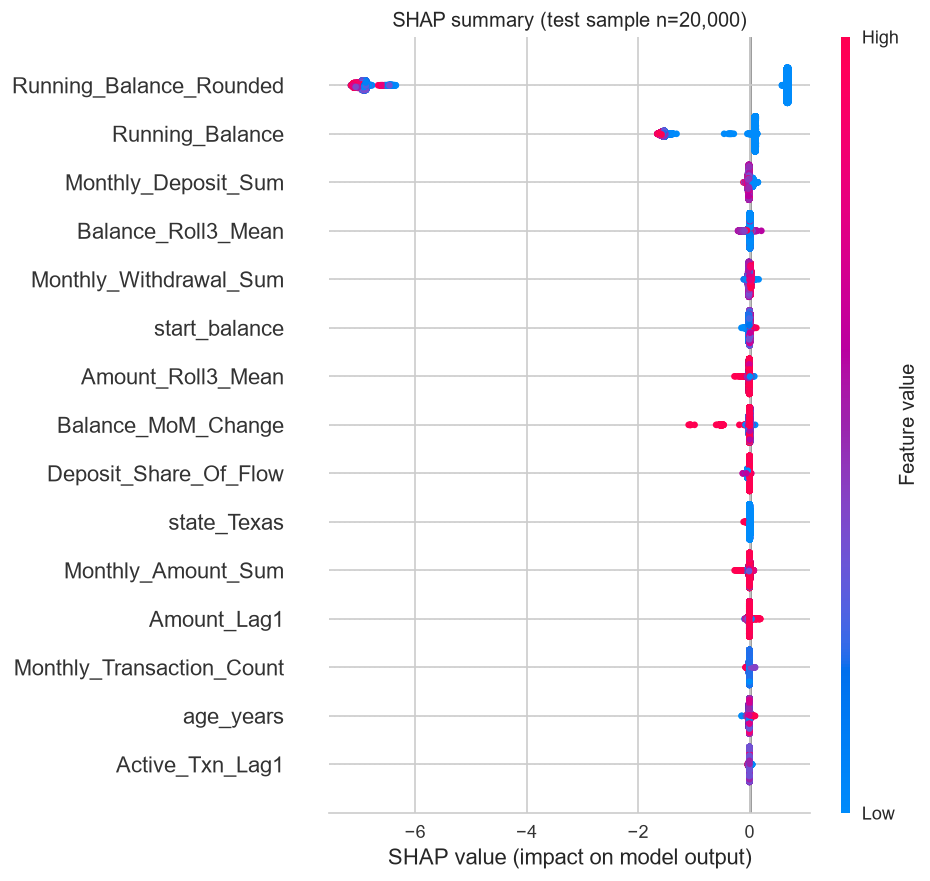
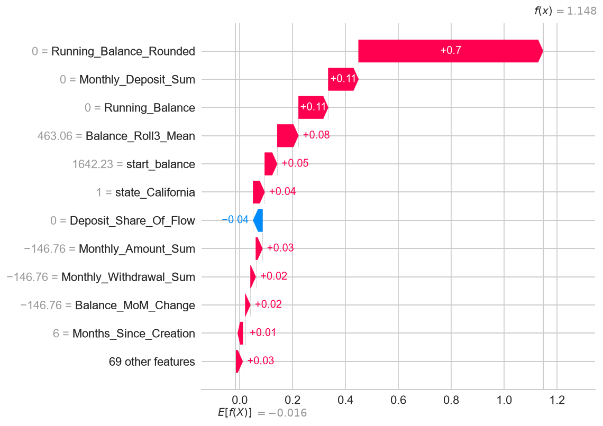
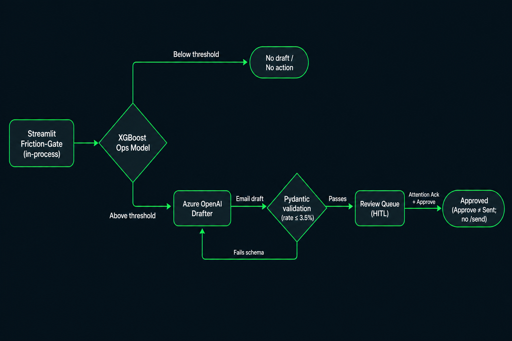
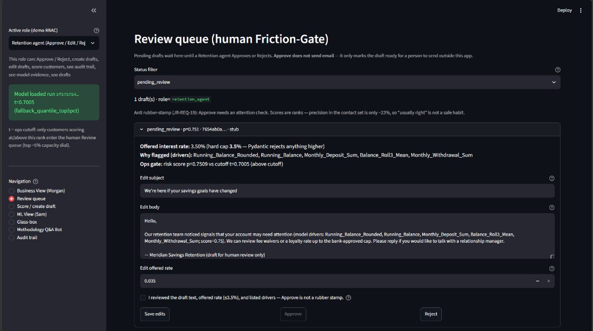
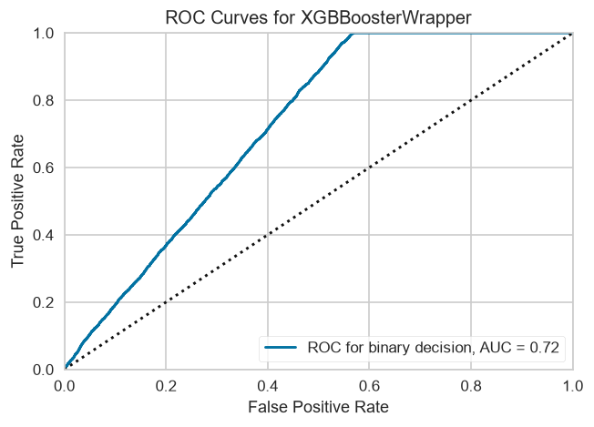
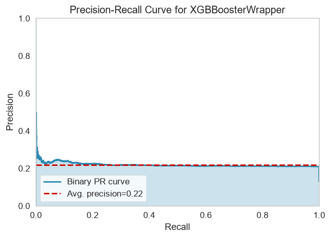
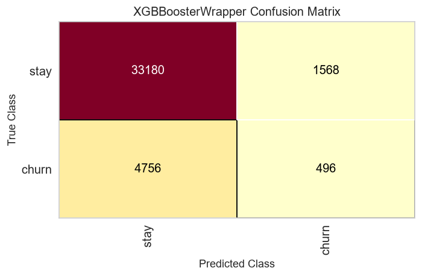

# Final Report: Meridian Savings Churn Prediction & Retention System

> **Status clarification, 2 November 2026:** This course prototype has no production customers or measured retention gains. The original report date is retained; fairness, calibration, retrieval and deployment statements below were reconciled against committed code and records on this date.


**Project:** InnovatorProjectDF14  
**Date:** 2026-09-24<br>
**Primary Stakeholders:** Morgan (Product), Sam (Data Science), Jamie (Risk & Compliance)  
**Model version:** 1.1.0-sprint3-serving · MLflow ops run `3f575754ae9a42c5a21ea5e476c0af37`

---

## 1. Executive Summary

Meridian Savings faces approximately **$7.3M in historical Assets Under Management (AUM) at risk** from silent retail savings churn. This project delivers a **leakage-safe ranking model** plus a **human-in-the-loop GenAI retention workflow** so Operations can prioritise outbound contact before balances drain.

**What we built:** An XGBoost classifier that ranks customer-months by next-month churn risk, served via FastAPI (`Models/ops/`) and consumed by the Friction-Gate Streamlit application. For customers above the operational contact threshold (`p ≥ 0.701`, top ~5%), the currently configured Azure OpenAI deployment (`gpt-5-mini`, which replaced `gpt-4o-mini` in September 2026) drafts personalised retention emails under strict guardrails. A RAG Q&A bot grounds methodology answers in this report and related documentation.

**Headline performance (test window 2017-09 → 2020-04):** PR-AUC **0.219** vs heuristic **0.151**; ROC-AUC **0.723** vs **0.551**. At the ops cut, test precision is **22.9%** with **20,127** false positives — a **12×** reduction versus a max-F1 threshold that would flood the review queue.

**Key recommendation:** Hand over the portable `Models/ops/` bundle and Friction-Gate UI to Retention Operations. Keep the ops cut at **`t = 0.70055`** (validation top-5% quantile). Do not lower the threshold to chase recall without expanding human review capacity. Azure Container Apps hosting is **proven but not standing**: `azd up` deployed and verified the API on 2026-09-24, and it was then torn down, so there is no live ACA URL in this handover.

**Major caveats (read before use):**

1. **Scores are ranks, not calibrated probabilities.** Training used `scale_pos_weight`; a score of 0.75 means “very high in the portfolio,” not a 75% actuarial churn chance.
2. **Aspirational ROC-AUC > 0.85 (PRD) was not achieved.** Shipped Definition of Done was **beat the `gone_this_month` heuristic** on PR-AUC and ROC-AUC, plus a reviewable contact queue — not the old AUC target.
3. **Azure Container Apps hosting was proven, then torn down; it is not production-live.** Local FastAPI + Streamlit are DoD-complete, and the FastAPI Docker image is built and smoke-tested locally (2026-09-24). On 2026-09-24 the `azd` project (`azure.yaml`, `infra/*.bicep`, one replica) deployed the API to Azure Container Apps and passed live checks (Azure drafts, hybrid RAG, RBAC). It was then removed with `azd down` to stop charges, so there is no standing URL. Redeploy with `azd up` ([ADR 016](https://github.com/Jacquesdtt/meridian-ai-engineering-portfolio/blob/main/Docs/Architecture/ADRs/016-azure-container-apps-via-azd.md)).
4. **Fairness gaps remain and are disclosed.** Equalized Odds at the ops cut is ≈ **0.16** (age) and ≈ **0.32** (state, filtered). We did not ship an automated fairness remediator.

---

## 2. Scope and Purpose

### Use Case

This system informs **outbound retention prioritisation**: which retail savings customers are most likely to enter next-month left-looking churn (rounded balance `$0` **and** inactive). For the highest-ranked cohort, it generates **draft** retention emails (competitive rates capped at **3.5%**) for human review — never autonomous send.

### In Scope

| Item | Detail |
|------|--------|
| **Portfolio** | US retail savings accounts, monthly customer×month grain |
| **Prediction window** | Features through month-end **t**; label = churn state in month **t+1** (ADR 004) |
| **Scoring population** | Customer-months with `Months_Since_Creation ≥ 2` (new-account grace) |
| **Submission horizon** | Predict June 2020 churn for accounts active as of **2020-05-31** (`StartingFiles/banking-churn-genai-project.md`) |
| **Intended users** | Retention agents (Friction-Gate queue), Morgan (portfolio/at-risk views), Sam (ML audit via MLflow/SHAP), Jamie (fairness + HITL evidence) |

### Out of Scope

* **Autonomous execution** — no `/send` endpoint; Approved ≠ Sent (ADR 003).
* **Dormant high-balance accounts** — inactive but still holding AUM are not labelled churn.
* **Non-retail products** — commercial, mortgage, credit excluded.
* **Probability calibration** — not implemented; needed before interpreting scores as churn probabilities. **Model improvement** is separate work if higher precision is required at the same review capacity.
* **Production Entra ID RBAC** — demo Glass-Box roles only (ADR 007).

---

## 3. Portfolio Description

### Product Context

Meridian Savings offers a retail savings product aimed at middle-income professionals. Interest accrues monthly only when the account shows a **net positive** change after deposits and withdrawals — so consistent deposit behaviour matters to both the customer and the bank’s liquidity buffer. Silent churn (balance drain to near-zero with inactivity) removes funding capacity; the historical AUM-at-risk baseline locked in Sprint 1 is **≈ $7.27M / ~$7.3M**.

### Data Sources and Period

| Source | Role |
|--------|------|
| `StartingFiles/customers_tm1_e.csv` | Demographics, `start_balance`, `creation_date` |
| `StartingFiles/transactions_tm1_e.csv` | Cash movements aggregated to month-end |

Raw extracts span **2007-01-31 to 2020-05-31**. Sprint 1 aggregated transactions to a monthly panel from **March 2007 to April 2020**, exported as `Data/processed/training_data.csv`.

### Size and Composition

* **138,640** unique customers · **2,263,608** customer-month rows · **158** observation months  
* **55** geographic states/territories (one-hot encoded at train time)  
* **Baseline churn rate:** **11.76%** (positive class across eligible rows)  
* **AUM at risk:** prior-3-month maximum `Running_Balance` at first left-looking exit sums to **≈ $7.27M** (Sprint 1 EDA — replaces earlier placeholder figures)

### Portfolio Evolution and Demographics

Churn-shaped behaviour is rare (~1 in 9 eligible months). Age-band churn rates cluster tightly (**≈ 11.0–11.9%** across bands). Geographic variation exists but is modest among high-volume states (e.g. Texas **13.43%**, California **10.36%** on eligible rows — Sprint 1 §9 crosstabs). The portfolio skews toward a mature retail demographic (`age_years` in the feature set).

Approximately **8.15%** of raw transaction rows are system **$0 placeholders** (quiet months padded with zero-amount entries). This materially affects how inactivity must be measured — raw transaction counts alone cannot identify dormant months.

*Context for Morgan:* Heavy class imbalance means accuracy is misleading (an always-negative classifier reaches ~87% accuracy while catching zero churners). The business value is in **ranking** the right customers into a finite review queue, not maximising headline accuracy.

---

## 4. Data Processing

Data integrity and leakage prevention were the highest priorities (Sprint 1). The steps are recorded in `Code/Sprint1/01_data_integrity_and_eda.ipynb` and `Code/Sprint1/02_feature_engineering.ipynb`. Reproduction requires the original course CSVs, which are absent from this public checkout.

### 4.1 Data Quality Issues and Resolutions

| Issue | Finding | Resolution |
|-------|---------|------------|
| **$0 placeholder transactions** | 523,679 / 6,421,943 rows (8.15%) | Exclude from activity; use `Monthly_Active_Txn_Count` (non-zero amounts only) |
| **Null `start_balance`** | 3 customers | Sam-confirmed **`fillna(0)`** |
| **Extreme balance outliers** | ±1e10 present | Retained; XGBoost partitions without destructive scaling |
| **`Active_Txn_Lag3` NaNs** | ~138k early-tenure rows | Retained; tree model handles missing natively |
| **Invalid / duplicate checks** | Integrity checklist §2.1 | Documented pass/fail triage; 100% 1:1 account–customer mapping |
| **High-balance dormancy** | ~53k streaks min balance ≥ $1,000 | **Not** labelled churn — AUM preserved |

### 4.2 Target Definition (ADR 004)

After stakeholder workshops with Sam (2026-07-10), churn at observation month **t** (`Months_Since_Creation ≥ 2`) is:

```text
Is_Churned = 1  iff  month t+1 has
    Running_Balance_Rounded == 0
    AND Monthly_Active_Txn_Count == 0
```

One-month forward label chosen over two-month confirmation (~2.6% positive rate) because most near-zero inactive streaks are length 1 and Operations needs actionable lead time.

### 4.3 Feature Engineering and Anti-Leakage

* **Temporal shifting:** Rolling means, lags, and activity flags use data through month **t** only; label is **t+1**. Pre-shift sanity: `gone_this_month` matched `Is_Churned` at **81.75%** before the forward shift — confirming the heuristic aligns with the locked label.
* **Grain:** Customer × calendar month (pandas month-end timestamps).
* **Exclusions from model matrix:** `customer_id`, raw `Month` strings (memorisation risk).
* **Encoding:** `state` one-hot fit on **train split only**; 24 numeric behavioural/demographic columns → **80** model inputs after encoding (`Models/ops/serving_meta.json`).

Schema validation: `py -3.13 .cursor/skills/validate-csv-schema/scripts/validate_schema.py` against `StartingFiles/*.csv`.

---

## 5. Model Methodology

### 5.1 Model Inputs / Outputs

| | Detail |
|---|--------|
| **Inputs** | 80 features: OHE state (55 levels + sentinels), balances, 3-month rolls, deposit/withdrawal flows, inactivity streaks, `age_years`, tenure |
| **Output** | Continuous score in `[0, 1]` from XGBoost `binary:logistic` — used as a **ranking** score |
| **Population scored** | Eligible customer-months (`Months_Since_Creation ≥ 2`); course submission targets active accounts at **2020-05-31** |
| **Ops flag** | `flagged = (score ≥ 0.701)` per `Models/ops/serving_meta.json` |

### 5.2 Overview — Algorithm and Training

**Algorithm:** XGBoost (`binary:logistic`) — chosen over deep tabular models and logistic regression because it (1) handles NaNs in lag features without imputation, (2) tolerates balance outliers without scaling, and (3) integrates with SHAP for board-defensible explanations (Jamie “Glass-Box” requirement).

**Temporal split (no shuffle):**

| Split | Months | Rows | Positive rate |
|-------|--------|------|---------------|
| Fit | 2007-03 → 2016-08 | 1,568,631 | 11.21% |
| Validation | 2016-09 → 2017-08 | 189,114 | 12.58% |
| Test | 2017-09 → 2020-04 | 505,863 | 13.15% |

**Hyperparameter approach:** Fixed tree hyperparameters with early stopping on validation log-loss (not exhaustive search — documented recipe from Sprint 2 notebook):

| Parameter | Value |
|-----------|-------|
| `max_depth` | 6 |
| `learning_rate` | 0.08 |
| `subsample` / `colsample_bytree` | 0.8 |
| `n_estimators` (max) | 400 |
| `early_stopping_rounds` | 40 |
| **Best iteration** | 99 |
| Class imbalance | `scale_pos_weight = n_negative / n_positive` |

**MLOps:** Experiments logged to MLflow (SQLite `mlflow.db`, gitignored). Ranking run `7134cee0…` (max-F1 threshold); ops run **`3f575754ae9a42c5a21ea5e476c0af37`** (top-5% threshold) registered for serving export to `Models/ops/`.

### 5.3 Assumptions and Limitations

* **Uncalibrated probabilities:** `scale_pos_weight` inflates raw scores. Do not interpret 0.70 as a 70% churn probability without separate calibration (calibration was not implemented; it needs a separate calibration slice and validation).
* **Macro stationarity:** Model trained on 2007–2020 patterns; material regime change requires retrain.
* **Precision ceiling:** Validation precision tops ~**0.23–0.24** even at top 1%; Morgan’s aspirational 40% precision ∩ 5% contact was **infeasible** on these scores without model lift.
* **Geographic encoding noise:** Duplicate state spellings (e.g. `California` vs `CALIFORNIA`) inflate cardinality — documented technical debt, not a fairness fix.

### 5.4 Model Interpretation

**Global drivers (SHAP mean |value|, test sample):**

1. `Running_Balance_Rounded` (3.004)  
2. `Running_Balance` (0.640)  
3. `Monthly_Deposit_Sum` (0.022)  
4. `Balance_Roll3_Mean` (0.022)  
5. `Monthly_Withdrawal_Sum` (0.015)

*Figure 1 — SHAP summary: global feature impact on churn score. Balance-drain mechanics dominate; demographics are not primary drivers.*



*Context for Sam:* Driver hierarchy is **consistent with ADR 004** (next-month zero balance + inactivity). Sprint 1 Gini leak screen showed top feature importance ≪ 0.50 — no single feature “memorises” the label.

**Local explanations:** Per-customer waterfall plots decompose a prediction into positive (red) and negative (blue) contributions. At serve time the API computes the same decomposition for any customer on request: exact TreeSHAP from the served XGBoost booster (`pred_contribs`), in log-odds, grouped back to the 24 raw features, and verified to sum to the customer's score. Sam's **Prediction browser** page shows it as a bar chart for the selected customer (§6.3). The Friction-Gate **Glass-box** page still surfaces the frozen global SHAP metadata for audit.

*Figure 2 — SHAP waterfall for a high-risk customer: local evidence for retention agents.*



---

## 6. Implementation

### 6.1 Packaging and Architecture

Portable serving bundle — **`Models/ops/`** (committed, single source of truth):

| Artifact | Purpose |
|----------|---------|
| `booster.json` | Frozen XGBoost model |
| `preprocessor.joblib` | Train-fitted OHE + column order |
| `serving_meta.json` | Ops threshold, feature names, MLflow run provenance |

*Figure 3 — System flow: scoring API, SQLite draft queue, Friction-Gate UI, optional Azure GenAI.*



**FastAPI** (`src/serving/app.py`) — key endpoints:

| Method | Path | Role |
|--------|------|------|
| GET | `/health`, `/docs` | Health + OpenAPI |
| POST | `/score` | Score features; returns probability + `flagged` at ops cut |
| POST/GET/PATCH | `/drafts` | Draft queue (SQLite WAL) |
| GET | `/audit/events` | Demo audit trail |
| GET | `/predictions` | Prediction browser: cohort re-scored server-side, ranked, filterable |
| GET / POST | `/predictions/{id}/explain`, `/explain` | Per-customer TreeSHAP (log-odds, grouped to raw features) |
| — | `/send` | **Absent by design** (ADR 003) |

**Demo permissions (not authentication):** `X-Demo-Role` header required on protected routes; Compliance viewer receives **403** on Approve (ADR 007).

**Docker:** `Dockerfile` + `docker-compose.yml` run the **FastAPI service only** (Streamlit stays on the host, ADR 008), with a named volume for the SQLite draft queue and a `/health` `HEALTHCHECK`. The image installs pinned serving-only dependencies (`requirements.serving.txt`, same versions that exported `Models/ops/`). Local build + smoke test passed on 2026-09-24 ([checklist](https://github.com/Jacquesdtt/meridian-ai-engineering-portfolio/blob/main/Docs/Sprint5/docker_smoke_checklist.md)). An Azure Developer CLI project (`azure.yaml` + `infra/main.bicep`, `infra/resources.bicep`) now describes the Azure Container Apps target: one replica (**min = max = 1**, ADR 008), image built locally, pushed to Azure Container Registry and pulled with a managed identity, Azure OpenAI key read from the existing AI Services resource at deploy time, ingress limited to one IP range, and the later API-key middleware requires a secret `X-API-Key` except on CORS preflights ([ADR 016](https://github.com/Jacquesdtt/meridian-ai-engineering-portfolio/blob/main/Docs/Architecture/ADRs/016-azure-container-apps-via-azd.md)). The earlier image was deployed and checked on 2026-09-24, then removed with `azd down`; there is no standing URL. That live check preceded the API-key middleware. The key gate has local tests, but its Azure check remains open. Cloud SQLite used ephemeral container disk; the local Compose volume does not establish cloud durability.

### 6.2 How to Run (Handover)

From repository root (`cmd.exe`, AppLocker-safe `py -3.13 -m …`):

```cmd
set PYTHONPATH=%CD%
py -3.13 -m pytest tests -q
py -3.13 -m uvicorn src.serving.app:app
py -3.13 -m streamlit run Code\Sprint3\friction_gate_app.py
```

Alternatively, run the API in Docker with `docker compose up -d --build`, then start Streamlit as above (the UI calls the API on port 8000).

Automated regression: **127 tests passed** (full `tests/` suite) as of 2026-09-24.

### 6.3 Friction-Gate Streamlit Application

*Figure 4 — Friction-Gate dashboard: business metrics, review queue, and role-gated actions.*



| Page | Audience | Capability |
|------|----------|------------|
| **Business View (Morgan)** | Product | Portfolio KPIs; **High / Medium / Low** risk buckets (see below) |
| **Score / create draft** | Retention | Score customer; create draft **only if flagged** |
| **Review queue** | Retention | Approve / Edit / Reject with **attention acknowledgement** (`attention_ack=true`, JR-REQ-19) |
| **ML View (Sam)** | Data Science | Interactive What-If: start from a demo customer, move four features (including `Running_Balance`, the top SHAP driver) and re-score live, with the edited row's per-customer SHAP; precision-recall and ROC curves |
| **Prediction browser (Sam)** | Data Science, Compliance | Every customer in the cohort ranked by score, filterable (flagged only, minimum probability, id); selecting a row shows that customer's SHAP breakdown. The cohort (`Data/processed/prediction_cohort.csv`, one month of `training_data.csv`) is built locally with `Code/Sprint5/build_prediction_cohort.py`; without it the page lists the two demo fixtures and says so |
| **Glass-box** | Compliance | Frozen ops threshold + SHAP drivers; demo role cannot Approve |
| **Audit trail** | Compliance | Immutable status transitions (`X-Demo-Role` Glass-Box RBAC) |
| **Methodology Q&A Bot** | All | RAG over project documentation |

**Business-readable risk buckets (brief requirement):** Morgan’s view labels cohorts **High / Medium / Low** rather than raw probabilities. **High (Tailored)** maps to the ops contact policy (`p ≥ 0.701`) and is the only cohort that enters the Friction-Gate draft queue. Medium/Low are UI cohort labels for portfolio communication; **outbound GenAI drafts are capacity-gated at the High cut only** — there is still no `/send` and no autonomous mailer.

Below-threshold customers (e.g. score ≈ 0.21) are **not flagged** — the capacity gate refuses GenAI side effects.

### 6.4 GenAI Extensions — Guardrails End-to-End

**Retention email drafting**

| Control | Implementation |
|---------|----------------|
| **Prompt-as-code** | Versioned `src/genai/prompts/retention_draft.prompty` supplies the system and user messages; the call requests a JSON object response. Token limits are set per model by `chat_limit_params()` (`max_completion_tokens` for reasoning deployments such as `gpt-5-mini`, which reject `max_tokens` and custom `temperature`) |
| **PII filtering** | Blocked keys and common email, phone, SSN, long-digit and date patterns are filtered before draft calls. This is not full name/entity detection or a provider data-retention guarantee; numeric account context can remain. |
| **Prompt instructions and output checks** | Prompt instructs the model not to invent names or rates. JSON parsing and Pydantic validate structure and numeric rate limits; they do not establish factual accuracy. Rates written in words and other unsupported claims still need human review. |
| **Pydantic hard stop** | `offered_interest_rate ≤ 0.035` validated on create **and** PATCH (ADR 002) and numeric percentage claims in subject/body must not exceed the validated offer |
| **Server-side re-score** | `POST /drafts` re-scores from raw features and rejects client-supplied scores (`extra="forbid"`); the Streamlit UI calls this API for every score, draft and decision, so it cannot bypass `t ≈ 0.70055`. Only on AppLocker machines with `FRICTION_GATE_MODE=inprocess` does it drive the same app without a socket (ADR 006 follow-on) |
| **Path cascade** | `stub` (offline demo) → `azure` (the configured `AZURE_OPENAI_DEPLOYMENT`, currently `gpt-5-mini`; it replaced `gpt-4o-mini` in September 2026) when configured → `stub_fallback` on Azure/prompty failure (`drafter_source` recorded) |
| **Telemetry** | Stdlib logs `prompt_tokens` / `completion_tokens` / `total_tokens` per completion (ADR 013); retries on 429/5xx via Tenacity |
| **HITL** | Status `pending_review` → human Approve/Edit/Reject; **Approved ≠ Sent**; no `/send`; terminal drafts immutable; `attention_ack` required |

Stakeholders can inspect the exact prompt file and pytest evidence (`tests/genai/test_pii_scrubber.py`, serving rate-cap tests) rather than trusting slide claims.

### 6.5 Methodology RAG Q&A Bot (Sprint 5)

| Aspect | Detail |
|--------|--------|
| **Engine** | `src/genai/rag_engine.py` — pure Python; no Chroma/FAISS (ADR 010 / AppLocker) |
| **Corpus** | Chunked markdown grounded on `Docs/Final_Report_Official.md` (Streamlit Methodology tab) |
| **Chunking** | Split on any ATX header (`#`–`######`), then paragraph-pack to ≤1200 chars (avoids whole-chapter “chunks”) |
| **Retrieval** | **Hybrid** (ADR 015): Okapi BM25 and, when Azure is configured, `text-embedding-3-large` cosine similarity are ranked separately and fused with Reciprocal Rank Fusion; the same chat deployment then reranks the candidate pool in one call. **`top_k=3`** chunks go into the answer prompt. Offline, BM25 alone is used. Not a purpose-built cross-encoder |
| **Cache** | Disk JSON `Data/processed/rag_index_cache.json` keyed by source mtime + embedding model + **schema_version** (invalidates on edit or chunker upgrade) |
| **Generation** | Azure chat answering **only** from retrieved context; safe error string if Azure unavailable |
| **Limits** | In-memory / disk index sized for report-scale corpus — not a bank-wide knowledge base; expand corpus only with re-index |
| **Resilience** | Tenacity backoff + token usage logs (ADR 013) |

**Friction controls (Jamie):** Drafts remain `pending_review` until human Approve; **Approved ≠ Sent**; terminal states immutable; demo Glass-Box RBAC (ADR 007) — Compliance viewer is read-only.

---

## 7. Model Testing

### 7.1 Metrics — Why PR-AUC?

With **11.8%** baseline churn, accuracy rewards “predict nobody churns.” **PR-AUC** (area under precision–recall) is the primary metric because Operations cares about **precision among flagged customers** at a fixed contact budget. **ROC-AUC** is reported secondary. Both must **beat the `gone_this_month` heuristic** — a real baseline that mirrors ADR 004 mechanics.

### 7.2 Ranking Performance (Test Set)

| Model | PR-AUC | ROC-AUC |
|-------|--------|---------|
| Always-negative | 0.132 | n/a |
| `gone_this_month` heuristic | 0.151 | 0.551 |
| **XGBoost** | **0.219** | **0.723** |

*Figure 5 — ROC curve: discrimination vs heuristic on chronological test split.*



*Figure 6 — Precision–recall curve: primary ranking metric for imbalanced churn.*



Ranking metrics are **unchanged** across threshold policies — only the operating point moves.

### 7.3 Calibration

We report calibration **honestly:** scores are **ranks, not calibrated probabilities.** Training used `scale_pos_weight`, which shifts the score distribution upward relative to the 11.8% base rate. A score of `0.70` means “top of the portfolio ranking,” not a 70% actuarial chance of churn.

**Brier score was not computed** and is not reported here. The brief lists Brier as a reasonable default for probability quality; we deliberately prioritised **PR-AUC / ROC-AUC ranking** and a capacity-limited operating point because Friction-Gate selects a top-k queue. Applying Platt scaling or isotonic regression was **not** shipped — sigmoid/Platt calibration preserves ranking, while isotonic calibration can introduce ties. Calibration needs separate validation before probability claims are made. If Sam later requires actuarial probabilities (e.g. for expected-loss pricing), calibration becomes a follow-on workstream, not a silent claim of this release.

### 7.4 Sensitivity — Threshold Policy (Capacity Dial)

Two policies on the **same** frozen test scores:

| Policy | Run ID | Rule | Threshold | Test precision | Test recall | Test FP | Test TP |
|--------|--------|------|-----------|----------------|-------------|---------|---------|
| Max F1 (first cut) | `7134cee0…` | argmax F1 on val | 0.475 | 0.211 | 0.9997 | **248,778** | 66,485 |
| **Ops (shipped)** | **`3f575754…`** | **val top-5% quantile** | **0.70055** | **0.229** | **0.090** | **20,127** | 5,964 |

*Context for Morgan:* Max-F1 optimises statistical recall but produces an **unreviewable queue**. The top-5% dial trades recall for **12× fewer false positives** while slightly improving precision — the only policy compatible with finite agent capacity. A 40% precision floor at 5% contact was **mathematically infeasible** on validation (precision plateaus ~0.23).

*Figure 7 — Confusion matrix at ops threshold: reviewable false-positive volume.*



### 7.5 Fairness and Anti-Discrimination (Jamie — JR-REQ-01/02)

Meridian’s fairness posture is **measurement plus governance**, not a claim of zero disparity. Because the model triggers a **positive intervention** (retention offer) rather than denial of service, our objective is to **constrain unsupervised harm**, **explain behaviour**, and **disclose residual gaps** for Risk oversight — without deploying an automated fairness remediator we did not validate.

**Protocol:** Fairlearn **Equalized Odds difference** (primary fairness metric — **not** Demographic Parity as the headline claim) on a **100,000-row** test subsample at the **same ops threshold** (`t = 0.70055`) used in serving — not at the max-F1 cut where near-universal recall distorts slice metrics. Selection-rate gap by age is reported as a secondary residual, not as the fairness gate.

**Results (filtered, min group n ≥ 500) — residual gaps, not “cleared”:**

| Slice | Groups kept | Equalized Odds diff | Notes |
|-------|-------------|---------------------|-------|
| Age (6 bands) | 6 / 6 | **≈ 0.156** | Selection-rate gap ≈ 0.099 (residual) |
| State | 38 / 55 | **≈ 0.318** | 3,548 sparse rows excluded (residual) |

The earlier unfiltered state EOD of **1.0** used the first operating cut and included sparse groups. The later filtered result uses the ops cut; it does not establish fairness for the excluded groups. The committed [JSON summary](Sprint2/reports/fairlearn_equalized_odds.json) records aggregate gaps and exclusions. The notebook exports a detailed slice CSV, but that CSV is absent from this public checkout; per-group rates and uncertainty cannot be checked from the summary alone.

**Measurement and review controls (not proof of nondiscrimination):**

1. **Measure at the serving cut** — Fairlearn EO at `t ≈ 0.701` so board numbers match the contact policy customers experience (`Docs/Sprint2/reports/fairlearn_equalized_odds.json`).
2. **Report sample limits** — Groups with **n < 500** are excluded from the reported comparison. This reduces sparse-group instability but leaves those groups unassessed; it does not remove their risk.
3. **Target overall capacity** — The fixed threshold is the validation top-5% quantile. It sets no per-demographic limit and does not guarantee a 5% queue on later data. Group selection rates can differ.
4. **Inspect model drivers** — SHAP attributes model output to inputs; balance-related features dominate the saved summary. Age and state are also model inputs (`Models/ops/serving_meta.json`). SHAP does not prove absence of discrimination, proxy effects, or causal bias.
5. **Govern with humans** — Friction-Gate HITL: drafts only, **Approve ≠ Sent**, no `/send`, Compliance role cannot Approve (ADR 003, ADR 007), attention acknowledgement before Approve (JR-REQ-19).
6. **Disclose residual gaps** — Age EOD ≈ 0.16 and state EOD ≈ 0.32 are on the model card and in this report. The project risk-review decision accepts periodic review and disclosure for this prototype; a production owner would need to set acceptance limits and may impose a hard EOD release gate (JR-OPEN-01 — resolved in ADR 012).

**What we did not claim:** no Fairlearn `ThresholdOptimizer`, no production EOD blocker, demo RBAC ≠ Entra ID, and PII filtering addresses selected keys and patterns in LLM payloads. It does not establish provider retention terms or demographic fairness.

**Drift monitoring:** Evidently train-vs-test report at `Docs/Sprint2/data_drift_report.html` (Morgan macro/context).

---

## 8. References

### External Methodology

1. Chen, T., & Guestrin, C. (2016). *XGBoost: A Scalable Tree Boosting System.* KDD.  
2. Lundberg, S. M., & Lee, S.-I. (2017). *A Unified Approach to Interpreting Model Predictions.* NeurIPS (SHAP).  
3. Hardt, M., Price, E., & Srebro, N. (2016). *Equality of Opportunity in Supervised Learning.* NeurIPS.  
4. Weerts, H., et al. (2023). *Fairlearn: Assessing and Improving Fairness of AI Systems.* Journal of Machine Learning Research.  
5. Saito, T., & Rehmsmeier, M. (2015). *Precision-Recall-Gain Curves.* (PR-AUC motivation under imbalance.)

### Internal Provenance

| Document | Path |
|----------|------|
| Architecture Decision Records | `Docs/Architecture/ADRs/` (002, 003, 004, 005, 007, 008, 010, 013) |
| Data Dictionary | `Docs/Data/Data_Dictionary.md` |
| Model card | [Current model card](Model_Card.md) |
| Ops run summary | `Docs/Sprint2/reports/sprint2_run_summary_v2.json` |
| Fairness narrative | `Docs/Sprint5/fairness_anti_discrimination_narrative.md` |
| Demo runbook | `Docs/Sprint4/demo_runbook.md` |
| GenAI prompt | `src/genai/prompts/retention_draft.prompty` |

---

## Appendix

### A.1 Operating Point (Canonical JSON)

Source: `Docs/Sprint2/reports/sprint2_run_summary_v2.json` · run `3f575754ae9a42c5a21ea5e476c0af37`

```json
{
  "test_window": { "start": "2017-09", "end": "2020-04", "rows": 505863 },
  "threshold_rule": "fallback_quantile_top5pct",
  "threshold": 0.700547993183136,
  "metrics": {
    "precision": 0.2285845693917443,
    "recall": 0.08968151333794472,
    "f1": 0.128821833183934,
    "roc_auc": 0.7234409965641873,
    "pr_auc": 0.21892221597538156,
    "true_positives": 5964,
    "false_positives": 20127,
    "false_negatives": 60538,
    "true_negatives": 419234
  }
}
```

### A.2 Threshold Sensitivity (Before / After)

| | Max F1 (`7134cee0…`) | Ops top-5% (`3f575754…`) |
|--|----------------------|---------------------------|
| Threshold | 0.475 | 0.701 |
| Test FP | 248,778 | 20,127 |
| Test TP | 66,485 | 5,964 |
| Test precision | 0.211 | 0.229 |
| Test recall | 0.9997 | 0.090 |

### A.3 GenAI Guardrails — Evaluation Notes

| Control | Evidence |
|---------|----------|
| Rate cap ≤ 3.5% | Pydantic validation tests in `tests/serving` |
| PII filtering | `tests/genai/test_pii_scrubber.py`; key/pattern checks, not a provider retention agreement |
| No `/send` | OpenAPI + `tests/serving` route assertions |
| HITL / attention ack | JR-REQ-19 UI gate + API tests |
| Azure retry / token log | `tests/genai/test_azure_retries.py`, `test_rag_engine.py` (ADR 013) |
| RAG retrieval | Retrieve + cache tests; BM25 offline, optional dense fusion and LLM reranking (ADR 015). The legacy API mode label `tfidf` names the BM25-only path. Tests do not establish answer accuracy. |
| **Historical regression suite** | **47 passed** (`pytest tests/serving tests/genai -q`, 2026-07-17). Later local checks are dated in the [validation record](Portfolio/EVIDENCE.md); no fresh runtime or cloud check is claimed by this documentation revision. |

Prompts and responses are structured (JSON draft schema); stub path allows full demo without live Azure. When Azure is configured, drafts, RAG answers and reranking use the configured chat deployment (currently `gpt-5-mini`), and RAG retrieval embeds with `text-embedding-3-large`.

### A.4 Technical Debt and Next Work

| Item | Notes |
|------|-------|
| SQLite on Azure | One replica; demo database is on ephemeral container disk and is lost on a new revision (ADR 016). Local Compose uses a named volume. Durable cloud storage and multi-replica service require a database migration. |
| RAG index | Disk JSON cache (`Data/processed/rag_index_cache.json`); vector DB if corpus grows |
| ACA deployment | API deployed and checked on 2026-09-24, then removed; no standing endpoint. The API-key gate was added later and has local tests only; Azure verification remains open (ADR 016). |
| Submission CSV | Shipped: `Code/Sprint3/create_submission.py` → `submission_df14.csv` (17,599 rows; ADR 014); probabilities, not ops-cut labels |
| PDF export | [Report PDF](https://github.com/Jacquesdtt/meridian-ai-engineering-portfolio/blob/main/churn_report_df14.pdf) |
