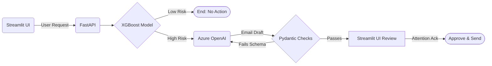
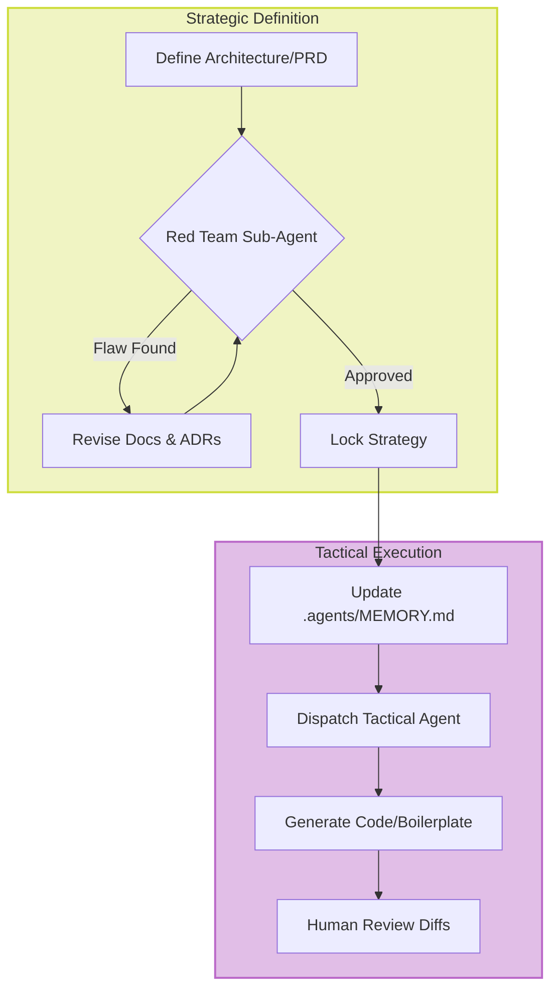

# Meridian Savings — Churn Ranking & Friction-Gate Handover

> [!NOTE]
> **Outline only.** The Kubrick PPTX pipeline (`generate_presentation.py` → `Meridian_Presentation_PresenterView.pptx` / `Meridian_Presentation_Standalone.pptx`) is the source of truth for the live handover deck. The Sprint 4 Marp crib (`Docs/Sprint4/presentation.md`) is **legacy**.

**Audience:** Sam (Data Science) · Morgan (Ops / Retention) · Jamie (Risk) · Assessors  
**Numbers:** [sprint2_run_summary_v2.json](../Sprint2/reports/sprint2_run_summary_v2.json)  
**Serve:** FastAPI + Streamlit Friction-Gate · ops cut `t≈0.701`  
**Model card:** [Model_Card_Template.md](../Model_Card_Template.md) `1.1.0-sprint3-serving`

> Tip: each `---` is a slide break (Marp / VS Code Markdown Preview Enhanced).

---

# Part 1: The Product & The ML Solution

---

## 1. The Business Problem & The Approach (Morgan)

*   **The Problem:** Historical AUM at risk (Sprint 1 validated): **~$7.3M**. Meridian is bleeding AUM due to silent customer churn.
*   **The Constraints:** The retention capacity is finite. We operate in a highly regulated domain requiring **Responsible AI, explainability, and risk mitigation**.
*   **The Approach:** We use a **Hybrid Architecture**. 
    *   **Tier 1: Predictive Engine (Traditional ML).** We explicitly rejected zero-shot Foundation Models for prediction to guarantee deterministic, mathematically verifiable, and explainable models (XGBoost) for regulators.
    *   **Tier 2: GenAI Extension (LLMs).** We use Azure OpenAI to craft highly targeted retention emails, strictly bound by Pydantic validation and Zero Data Retention policies.

---

## 2. Defining Churn (ADR 004) (Sam)

We did not have a simple "account closed" flag. We explicitly excluded high-balance dormant accounts (e.g., $10k balance but inactive) because they still hold AUM.

**Left-looking next-month churn:**
*   `Running_Balance_Rounded == 0` **and**
*   No active transactions in that month

**Anti-Leakage Split (Temporal, no shuffle):**
Training grain is customer × month. We strictly separated the *Observation Window* (features calculated up to month `t`) from the *Prediction Window* (label in month `t+1`). We trained on the past (≤ 2016-08), validated on the middle, and tested on the future (2017-09 → 2020-04) to avoid threshold-calibration leakage. 

---

## 3. Data Pre-processing & Exploratory Analysis (Sam)

*   **Handling Nulls:** Imputed missing opening balances with `$0`. Kept extreme balance outliers ($\pm1e10$) and missing values (NaNs in early-tenure features) to let our tree-based model partition them natively without destructive transformations.
*   **System Placeholder Filtering:** Explicitly filtered out `$0` system-generated placeholder transactions to prevent false-active signals.
*   **Cohort Behavior:** Confirmed that churn risk correlates heavily with account inactivity streaks; accounts inactive for two consecutive months are key drivers.
*   **Demographic Drivers:** Identified geography and age bands as high-variance slices for model scrutiny (key drivers for fairness analysis later).

---

## 4. Model Selection: Why XGBoost (Sam & Jamie)

We chose XGBoost (Gradient Boosted Trees) over deep learning or linear models for four reasons:
1.  **Requirement Constraints:** ML Fundamentals criteria forbade Zero-Shot GenAI for core prediction.
2.  **Native Missing Value Handling:** It seamlessly handles the NaNs from our lagged features.
3.  **Outlier Robustness:** Tree models partition data natively; extreme balance outliers didn't require heavy scaling transformations that skew linear models.
4.  **Explainability:** Works natively with `SHAP` (global summary + per-customer waterfalls), supporting the "Glass-Box" transparency mandate from Risk & Compliance. A `dtreeviz` surrogate tree was attempted but skipped because it cannot handle the Lag3 NaNs.

---

## 5. Ranking DoD — Beating the Heuristic (Sam)

| Model | PR-AUC | ROC-AUC |
|-------|--------|---------|
| Always-negative | 0.132 | n/a |
| `gone_this_month` heuristic | 0.151 | 0.551 |
| **XGBoost** | **0.219** | **0.723** |

**Do not lead with accuracy.** Always-negative ≈ **0.869** accurate and useless.  
Threshold-dependent accuracy is **not** the ranking DoD. We cleared the real bar on PR-AUC and ROC-AUC.

---

## 6. Ops Contact Policy — Capacity over Max-F1 (Morgan)

At validation-tuned **max F1** (`t = 0.475`), the model yielded ~248,778 false positives (~62% of test rows flagged). 
*   **Finding:** Ranking worked, but the operating point flooded Friction-Gate capacity.

**What we changed — decision policy, not ranking:**
We shifted from targeting 40% precision (mathematically infeasible given base churn rate) to a **Capacity-Constrained approach**.

| | Max-F1 | Ops top-5% |
|--|--------|------------|
| `t` | 0.475 | ≈ 0.701 |
| Test precision | 0.211 | **0.229** |
| Test FP | 248,778 | **20,127** (12x reduction) |
| PR-AUC / ROC-AUC | 0.219 / 0.723 | **same** |

---

## 7. Why we could not hit 40% precision (Sam & Morgan)

**Jury one-liner:** *“We can rank better than the heuristic, but we can’t promise a 40% hit rate from raw scores. We dialed capacity (top 5%) instead.”*

| Contact slice | Approx. selection | Val precision |
|---------------|-------------------|---------------|
| Top 50% | 50% | ≈ 0.21 |
| Top 10% | 10% | ≈ 0.23 |
| Top 5% *(shipped)* | 5% | ≈ **0.23** |
| Top 1% | 1% | ≈ **0.24** |

**40% never appears.** Three reasons:
1.  **Scores are ranks, not calibrated probabilities:** We used `scale_pos_weight` for extreme class imbalance. Cutting higher shrinks the queue; it does not magically make the queue 40% true positives.
2.  **Modest overall PR-AUC:** 0.219 is a real win over the heuristic (0.151), but precision at the top stays in the low-mid 20%s.
3.  **Low base rate (~12%):** Hitting 40% means the model must be 3x richer than chance. If stakeholders demand >23% precision, that is a new work item (probability calibration or new signal), not a threshold hunt.

---

## 8. Explainability (SHAP) & Fairness (Jamie)

Top features driving predictions (test sample):
1. `Running_Balance_Rounded`
2. `Running_Balance`
3. `Monthly_Deposit_Sum`

**Preventing Discrimination:**
*   **Measure:** Fairlearn Equalized Odds on **age** + **state** at ops `t≈0.701`.
*   **Honest slices:** Groups with **n ≥ 500** only (reject sparse noise).
*   **Govern:** Explain with SHAP (behaviour-led, not demographic); limit contact capacity to top 5%.
*   **Disclose:** Age EOD ≈ 0.16 · State EOD ≈ 0.32 on the model card.

---

## 9. The "Meridian Framework" & GenAI Principles (Jamie)

When we leverage Azure OpenAI for Tier 2, we operate under strict guardrails:

*   **Zero Data Retention (ZDR):** We never send raw Personally Identifiable Information (PII) to the LLMs. All data must be scrubbed by middleware before hitting the Azure endpoints.
*   **Pydantic Determinism:** LLM outputs are notoriously unpredictable. Every single GenAI output must be structured and validated through **Pydantic schemas**. (e.g., Maximum hallucinatable interest rate is hard-capped at 3.5%).
*   **RAG Context Injection:** We ground generation by injecting semantic context (e.g., retrieving successful retention emails as templates).

---

## 10. Risk Mitigation & "Friction as a Feature" (Morgan & Jamie)

The biggest risk in GenAI tools is human "rubber-stamping". We treat **Friction as a Feature**.

In our Streamlit UI, an AI-generated email is locked in a "Pending Review" state. To approve it, the system enforces several gates:
*   **Attention Ack:** The operator must explicitly check a UI checkbox acknowledging the risks (`attention_ack=true`).
*   **High-Stakes Cues:** Strong visual warnings when score is well above ops cut.
*   **Auditing (`seconds_open`):** If a decision is made too fast (e.g. < 8s), a soft warning is triggered and logged on the audit trail.
*   **NO AUTONOMOUS SEND:** Architecture cannot dispatch emails even if UI is misused. "Approve" just means ready for a human to send outside the system.

---

## 11. System Flow & Architecture Commitments (Jamie)

| Commitment | Decision | ADR |
|------------|----------|-----|
| HITL / no autonomous send | Drafts only; **Approve ≠ Sent**; **no `/send`** | [ADR 003](../Architecture/ADRs/003-friction-as-a-feature-genai-gating.md) |
| Bounded GenAI I/O | Structured drafts; offered rate **≤ 3.5%** hard-fail | [ADR 002](../Architecture/ADRs/002-pydantic-strict-io.md) |
| Glass-Box oversight | Demo RBAC — Compliance can audit, **cannot Approve** | [ADR 007](../Architecture/ADRs/007-demo-glass-box-rbac.md) |

---

# Part 2: The Meta-Project — How It Was Built
*Professional setup, AI Orchestration, and System Architecture*

---

## 12. Professional Project Setup: PRDs, ADRs, & Model Cards

We did not start by opening a Jupyter notebook. We established a rigid, professional governance structure before a single line of code was written.

*   **Product Requirements Document (PRD):** We used a formal PRD to define the business problem, lock down the $7.3M AUM target, explicitly define stakeholder personas (Sam, Morgan, Jamie), and codify success metrics.
*   **Architecture Decision Records (ADRs):** Every major structural, database, or algorithmic shift was permanently logged as an ADR. If a developer joins the team in 6 months, they know exactly *why* we didn't use PostgreSQL (ADR 008) or *why* we chose 30-day forward-looking churn (ADR 004).
*   **Model Cards:** We shipped a formal Model Card (`Model_Card_Template.md`) documenting training data lineage, ethical considerations, and exact EOD fairness metrics, treating the ML model as a governed enterprise asset.

---

## 13. Execution Framework: Agile Rituals & Stakeholder Analysis

We managed this solo project using strict enterprise Agile frameworks to ensure velocity and alignment:

*   **Stakeholder Analysis:** We didn't build in a vacuum. Every feature was aggressively mapped to a specific persona: Sam demanded MLflow rigor, Morgan demanded queue manageability (Top 5% cut), and Jamie demanded Glass-Box RBAC and Zero Data Retention.
*   **Sprint Planning & Retrospectives:** Work was scoped into discrete Sprints (0-5). At the exact start of a sprint, an explicit `sprint_plan.md` was generated defining the Definition of Done. At the end, we generated a `sprint_debrief.md` (what we delivered) and a `sprint_retrospective.md` (how we can work better).
*   **The Split-Executor Workflow:** We cleanly separated *Strategic Definition* (the what/why) from *Tactical Execution* (the how). We planned broadly, then narrowed execution down to focused, task-level files.

---

## 14. AI Pair Programming & Workflow Orchestration

Building this required shifting from "Syntax Writer" to "Systems Orchestrator." AI agents are brilliant but prone to Agentic Tunnel Vision. We solved this via the **Split Execution Workflow**: separating strategic architecture from tactical coding.

*   **Agentic Rules & MEMORY (`.agents/MEMORY.md`):** We maintained a strict, living "save state" memory file. Agents were forced to read and update this file before executing.
*   **Routing to Sub-Agents:** We dynamically dispatched specific tasks to specialized sub-agents (e.g., using a high-context "Red Team" agent to critique architectures).
*   **Workflow Orchestration:** Instead of trying to fix code manually, we orchestrated the AI. We defined the exact rules of engagement and reviewed the diffs.

---

## 15. Red Teaming & "Docs-Before-Code"

AI agents will eagerly write wrong code if you let them. We enforced an ironclad **"Docs-Before-Code"** circuit breaker.

1.  **Red Team Workflow:** Before finalizing Sprint Plans or Architectures, we explicitly spun up a specialized Red Team sub-agent to attack our own logic. This caught critical flaws *before* implementation.
2.  **The Cascade Prompt:** When a Red Team attack found a flaw, we didn't jump into code. We forced a strict cascade: `Attack Note -> Revision Checklist -> Update Architecture Docs -> THEN Write Code`.

---

## 16. Red Team in Action: Sprint 2 Modeling Critique

Our Red Team agent attacked the initial XGBoost ML execution plan *before* we wrote the training script, catching four critical flaws that would have ruined the model's validity:

1.  **Threshold Leakage:** The initial plan calibrated the ops threshold on the Test set. The Red Team flagged this as methodological leakage, forcing us to calibrate on Validation and freeze it for Test.
2.  **Probability Skew:** We needed `scale_pos_weight` for imbalance, but the Red Team proved this would destroy probability calibration. This directly led to our decision to treat outputs as **rankings**, not raw probabilities (see Slide 7).
3.  **AppLocker Memory Spikes:** XGBoost on 2.2M rows would crash the AppLocker container. The Red Team mandated `tree_method="hist"` for rapid, memory-efficient histograms.
4.  **Baseline Reality:** Forced us to hardcode the baseline PR-AUC (~0.117) so stakeholders wouldn't misinterpret the naive baseline.

---

## 17. Defending the Architecture (Red Team Mitigations)

**Defending the Pure-Python RAG (ADR 010):**
> "While vector databases like Chroma provide superior semantic search, our enterprise environment strictly blocks the native C++ compilers and DLLs they rely on via AppLocker. Our mandate is to deliver business value within security constraints, not fight IT. By implementing an in-memory, pure-Python retrieval engine, we guarantee zero execution blocks and zero installation footprint, perfectly aligning with our 'Friction as a Feature' philosophy. The tradeoff in slight semantic accuracy is heavily outweighed by achieving 100% deployability."

**Defending the Docker Volume SQLite Hack (ADR 008):**
> "Typically, a multi-container architecture demands a dedicated database server like PostgreSQL. However, our prototype's core requirement (ADR 006) mandates complete portability. By utilizing a shared Docker volume mapped to a single SQLite file, we maintain the self-contained, lightweight nature of the application. We have mitigated the inherent concurrency risks by implementing strict busy_timeout PRAGMAs and exponential backoff retry loops at the application layer."

---

## 18. Phase 6: Production RAG Roadmap

**Current State (Sprint 5):** 
Azure `text-embedding-3-large` + pure-Python cosine over **bounded** markdown chunks (`#`–`######`, ≤1200 chars), with TF-IDF offline fallback and disk index cache (`schema_version`). Designed to bypass AppLocker / avoid whole-report prompt stuffing. **No** cross-encoder rerank yet.

**Production Target:** 
Production requires **Hybrid Search (Keyword + Vector)** coupled with **Cross-Encoder Reranking**, and **Query Rewriting** before hitting the index. 

*   **Why?** We must rigorously measure and guarantee *retrieval quality* (precision/recall of context chunks) independently before we ever trust the LLM to generate an answer.
*   **Infrastructure:** Managed Vector Store (e.g., Azure AI Search) to offload semantic embeddings without triggering local OS-level execution blocks.

---

## 19. Sprint 5: Containerization, Multi-page UI, & RAG

*   **Docker Compose:** Wrapped FastAPI and Streamlit into portable containers (`docker-compose.yml`) for local and cloud deployment.
*   **Multi-Page Dashboards:** Split the UI into a Business View (Morgan) and an ML/What-If View (Sam) for persona-tailored experiences.
*   **RAG Q&A Bot:** Retrieval-Augmented Generation chatbot grounded in `Final_Report_Official.md` (bounded chunks + Azure embeddings when live).
*   **Anti-Rubber Stamp (JR-REQ-19):** Enhanced Risk gates with `attention_ack` checkboxes and `seconds_open` auditing to prevent review fatigue.

---

## 20. Demo path & handover

**Live UI script:** [dashboard_presentation_plan.md](dashboard_presentation_plan.md) (health → below-threshold → flagged → Approve≠Sent → role flips → Glass-box/audit → RAG DEMO Q).

1. `GET /health` — run id + threshold + `azure_configured`
2. Streamlit preset **Below threshold** (~0.21) → **no draft** (capacity discipline)
3. Preset **Flagged** (~0.75) → create draft → Approve / Edit / Reject
4. Say explicitly: **“Approved is not sent.”**
5. Role flips (DS readonly · Compliance view) → Glass-box / audit as needed
6. Methodology RAG — ask the DEMO Q in the dashboard plan (ops cut raised to ≈0.701 vs max-F1)

| Need | Where |
|------|-------|
| Dashboard live demo script | [dashboard_presentation_plan.md](dashboard_presentation_plan.md) |
| Methodology Report | [sprint_methodology_report.md](sprint_methodology_report.md) |
| Demo commands | [demo_runbook.md](../Sprint4/demo_runbook.md) |
| Model card | [Model_Card_Template.md](../Model_Card_Template.md) |

> We rank better than a strong heuristic, contact only the top 5% of scores so the queue is reviewable, and every GenAI draft stops at a human — by design.
