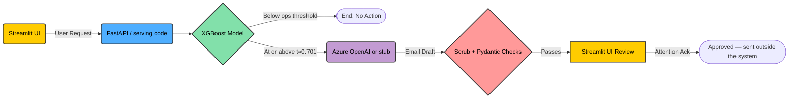

# Meridian Savings Churn Project: Technical Crash Course

Welcome to the **Meridian Savings Churn Project**. This document provides a rapid, high-density crash course on what we're building, how we're building it, and the strict guardrails we operate under.

Our objective is critical: we are predicting customer churn to protect **~$7.3M AUM (Assets Under Management) at risk**, and we are using Generative AI to draft targeted retention emails for human review. Because we operate in a highly regulated domain (financial services/risk), we prioritize **Responsible AI, explainability, and risk mitigation** over black-box automation.

---

## 1. The Core Architecture (Hybrid ML + GenAI)

We utilize a two-tiered architecture. We explicitly **do not** use zero-shot Foundation Models (like GPT-4) to predict churn. 

*   **Tier 1: The Predictive Engine (Traditional ML)**
    *   **Why:** To satisfy ML Fundamentals and Responsible AI criteria, our core churn prediction uses a traditional ML algorithm: **XGBoost** (`binary:logistic`). Tree models are deterministic, mathematically verifiable, and much easier to explain to regulators than LLMs.
    *   **Evaluation:** We do not blindly optimize for maximum F1 score (e.g., `0.475`). Instead, we evaluate and serve the model based on a strict operational threshold—the **"ops cut" (`t≈0.701`, top 5% of validation scores)**.
    *   **MLOps:** We use **MLflow** (SQLite backend, ADR 009) to track training runs, hyperparameters, metrics and reports on a single **time-based fit / validation / test split** (no cross-validation folds). Serving does not load from MLflow: the chosen run is exported to the portable `Models/ops/` folder (ADR 005), and its run ID is returned by the API and stored on every draft. No model is registered in the MLflow Model Registry yet. (Note: `mlflow.db` is gitignored; it serves as local provenance only).
*   **Tier 2: The GenAI Extension (LLMs)**
    *   **Usage:** Once a customer is flagged by Tier 1, we use Azure OpenAI (via a managed `.prompty` file) to draft a personalized retention email. Separately, a RAG (Retrieval-Augmented Generation) Q&A bot answers methodology questions about the official report.
*   **Explainability:** We use **SHAP** (SHapley Additive exPlanations) to interpret the model — a global summary plus example waterfalls in the Sprint 2 notebook. At serve time, drafts still carry only the model's top global SHAP drivers frozen in `serving_meta.json`. Separately, the API explains any single customer on request (exact TreeSHAP from the served booster), which Sam's Prediction browser shows as a bar chart. (`dtreeviz` was attempted but skipped: it cannot handle the `Active_Txn_Lag3` NaNs.)

---

## 2. The Tech Stack & Tooling

Our stack is built for fast iteration, local Windows execution, and strict separation of concerns.

*   **Serving Backend (FastAPI):** Exposes `/score`, `/drafts` and `/audit/events` (`src/serving/app.py`). Containerized via `Dockerfile` + `docker-compose.yml`.
*   **Frontend UI (Streamlit):** The "Friction Gate" application (`Code/Sprint3/friction_gate_app.py`) where human operators review and approve AI-generated drafts. It imports the serving code **in-process** (ADR 006), so it does not need the API running.
*   **Local Execution (Windows AppLocker Bypass):** On a corporate Windows machine with AppLocker enabled:
    *   **Crucial Rule:** You cannot execute `.venv/Scripts/python.exe`. 
    *   **Workaround:** Use the global Python launcher with the module flag: `py -3.13 -m <module>`. 
    *   *Example:* `py -3.13 -m pip install --user <package>` or `py -3.13 -m uvicorn src.serving.app:app`.
    *   On a machine without AppLocker (and without the `py` launcher), use `python -m <module>` inside a normal virtual environment instead — see `CLONE_GUIDE.md`.
*   **Testing:** Pytest is our testing framework. Run the whole suite via `py -3.13 -m pytest tests -q`.

---

## 3. The "Meridian Framework" & Core GenAI Principles

When we leverage Azure OpenAI, we do not allow the LLM to run wild. We operate under the "Meridian Framework":

*   **Zero Data Retention (ZDR):** We never send raw Personally Identifiable Information (PII) to the LLMs. Context is scrubbed by `pii_scrubber.py` before prompting, and the LLM's output is scrubbed again before it is stored.
*   **Pydantic Determinism:** Retention drafts are structured and validated through **Pydantic schemas** (`RetentionDraftBody`). For example, the offered interest rate is capped at `3.5%`: the drafter clamps any higher LLM value down to the cap, and Pydantic hard-rejects anything above 3.5% that reaches the schema. The LLM's own "drivers" are discarded and replaced with the server's SHAP driver names.
*   **Grounding:**
    *   **Retention drafts are not RAG-grounded.** They are constrained by the `.prompty` instructions, PII scrubbing, the 3.5% rate cap and server-side SHAP drivers. If Azure is not configured or fails, a deterministic stub draft is used (`drafter_source=stub` / `stub_fallback`).
    *   **The Methodology Q&A bot is RAG-grounded** on `Docs/Final_Report_Official.md` only (hybrid retrieval: BM25 + Azure embeddings fused with Reciprocal Rank Fusion, then an LLM rerank; BM25 alone offline; ADR 010 + ADR 015).

---

## 4. Risk Mitigation & "Friction as a Feature"

The biggest risk in GenAI tools is human "rubber-stamping"—where an operator blindly clicks "Approve" on an AI-generated email without reading it. To mitigate this review fatigue, we treat **Friction as a Feature**.

In our Streamlit UI, an AI-generated email is locked in a "Pending Review" state. To approve it, the system enforces several gates (e.g., **JR-REQ-19**):
*   **Attention Ack:** The operator must explicitly check a UI checkbox acknowledging the risks (`attention_ack=true`) before the API will accept the approval.
*   **High-Stakes Banners & Soft Warnings:** Visual cues remind the operator of the stakes.
*   **Auditing (`seconds_open`):** The system audits how long the email was visible on screen. If a decision is made in under 8 seconds, a **soft warning** is shown and `fast_decide_warn` is recorded in the audit trail. It is deliberately not a hard block.
*   **Approved ≠ Sent:** Approving a draft does not send anything. There is no `/send` endpoint; the agent sends outside the system (ADR 003).

---

## 5. Documentation & Agentic Workflows

We treat documentation as a first-class citizen—it is part of the Definition of Done.

*   **`.agents/MEMORY.md`:** This is our dynamic State Tracker. Read it at the start of every session to know exactly what sprint we are in, what was just accomplished, and the *next immediate step*. Update it before you log off.
*   **Continuous Documentation:** Sprints are documented in `Docs/SprintN/`. At the end of a sprint, we generate a `sprint_plan.md`, `walkthrough.md`, `sprint_debrief.md` (what we delivered), and `sprint_retrospective.md` (how we work).
*   **`docs-before-code` Workflow:** When revising code after a critique, we do not jump straight into notebooks. We follow an attack note → signed checklist → code → doc cascade.
*   **Architecture Decision Records (ADRs):** Any major structural change (database shifts, OS constraint bypasses) must be documented as an ADR in `Docs/Architecture/ADRs/`. 

---

## 6. Next Steps for Local Execution

To get your local environment spun up and verify everything is working, run the following commands in your terminal:

1. **Run the Test Suite:**
   ```bash
   py -3.13 -m pytest tests -q
   ```
2. **Start the Streamlit UI** (works on its own; calls the serving code in-process):
   ```bash
   py -3.13 -m streamlit run Code\Sprint3\friction_gate_app.py
   ```
3. **Optional — start the API backend** (for `/docs`, API clients, or Docker Compose):
   ```bash
   py -3.13 -m uvicorn src.serving.app:app
   ```

*Note: Docker Compose (API only) and the single-file Streamlit role routing (WS-5, ADR 011) are done. The Azure Container Apps deploy (WS-2) is still open — `infra/azure-container-app.yaml` is a scaffold, not a live deployment. Check `.agents/MEMORY.md` for the latest implementation steps before executing.*

---

## 7. System Architecture Diagrams

### 7.1 Complex Flow: Detailed System Journey
This flowchart illustrates the end-to-end journey emphasizing our core principles: Friction as a Feature, Pydantic Determinism, and Responsible AI.

```mermaid
flowchart TD
    %% Define Styles
    classDef frontend fill:#ffcc00,stroke:#333,stroke-width:2px,color:#000;
    classDef backend fill:#4eaeff,stroke:#333,stroke-width:2px,color:#000;
    classDef validation fill:#ff9999,stroke:#333,stroke-width:2px,color:#000;
    classDef ml fill:#82e0aa,stroke:#333,stroke-width:2px,color:#000;
    classDef genai fill:#c39bd3,stroke:#333,stroke-width:2px,color:#000;
    classDef db fill:#fcf3cf,stroke:#333,stroke-width:2px,color:#000;

    %% Streamlit Frontend
    subgraph Frontend [Streamlit UI "Friction Gate"]
        UI_Action[User Action / View Customer]
        UI_Review[Review AI Draft]
        UI_Approve[Approve Draft — not sent]
        AttentionAck{Attention Ack Checked?}
        
        UI_Action --> UI_Review
        UI_Review --> AttentionAck
        AttentionAck -- Yes --> UI_Approve
    end
    class Frontend,UI_Action,UI_Review,UI_Approve,AttentionAck frontend

    %% FastAPI Backend & Validation
    subgraph Backend [FastAPI / in-process serving code]
        API_Gateway[API Endpoint]
        Pydantic_In[Pydantic Validation: Input]
        Pydantic_Out[Pydantic Validation + Rate Clamp: Output]
        Scrub_PII[Zero Data Retention Scrubbing]
        
        UI_Action --> API_Gateway
        UI_Approve --> API_Gateway
        API_Gateway --> Pydantic_In
    end
    class Backend,API_Gateway,Pydantic_In,Pydantic_Out,Scrub_PII backend
    class Pydantic_In,Pydantic_Out validation

    %% Traditional ML & MLOps
    subgraph Predictive_Engine [Tier 1: Predictive Engine]
        MLflow[(MLflow Tracking — SQLite)]
        OpsExport[(Models/ops/ portable export)]
        XGBoost[XGBoost Model]
        Explain[Frozen global SHAP drivers]
        
        MLflow -. export_ops_model.py .-> OpsExport
        OpsExport -. loads .-> XGBoost
        Pydantic_In --> XGBoost
        XGBoost --> Explain
    end
    class Predictive_Engine,XGBoost,Explain ml
    class MLflow,OpsExport db

    %% GenAI Extension
    subgraph GenAI_Engine [Tier 2: GenAI Extension]
        AzureOpenAI[Azure OpenAI]
        Stub[Deterministic stub drafter]
        Prompty[.prompty Instructions]
        
        Scrub_PII --> AzureOpenAI
        Prompty --> AzureOpenAI
        AzureOpenAI -. not configured / fails .-> Stub
    end
    class GenAI_Engine,AzureOpenAI,Stub,Prompty genai

    %% Wiring the Flow
    Explain -- If score >= ops threshold --> Scrub_PII
    AzureOpenAI -- Generates Email Draft --> Pydantic_Out
    Stub --> Pydantic_Out
    Pydantic_Out -- Pending Review --> UI_Review

    %% Notes
    style AttentionAck stroke:#e74c3c,stroke-width:3px
```

The RAG Methodology Q&A bot is a separate path (Streamlit tab → `rag_engine.py` → `Docs/Final_Report_Official.md`) and does not feed the retention drafter.

### 7.2 Simplified Flow: Core Data Journey
A high-level view showing how user actions trigger traditional ML and conditionally flow into GenAI generation and validation.


