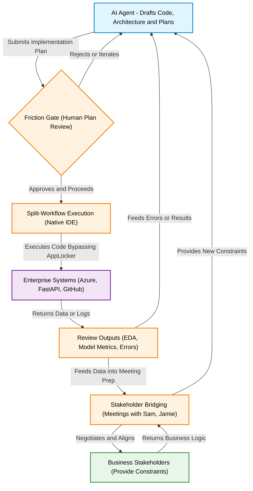

# The Orchestrator Workflow: AI-Augmented Engineering

This diagram visualizes your exact workflow as the human Orchestrator collaborating with an AI Agent in a heavily constrained enterprise environment.

### Key Workflow Pillars:

1. **The Friction Gate:** You intentionally slow down the AI to ensure all architectural decisions meet enterprise standards before execution.
2. **The Split-Workflow:** You act as the bridge between the AI's sandboxed environment and the actual local Windows hardware, bypassing corporate restrictions like AppLocker safely.
3. **Stakeholder Translation:** You are the human interface that translates raw data into business value, negotiating definitions (like "Churn") with actual leadership before bringing those rules back to the codebase.
