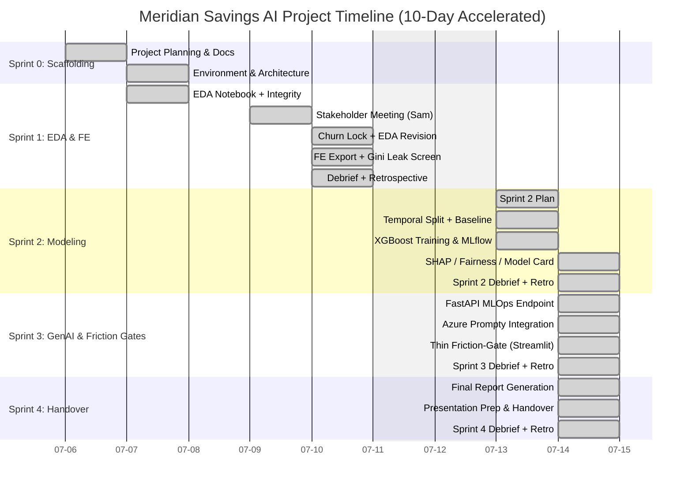

# Project Delivery Schedule

This document outlines the timeline and critical path for the Meridian Savings Churn project. The schedule is compressed into a rapid 10-day Agile sprint sequence.

**As of:** 2026-07-14  
**Status:** Sprint 0–5 **complete**. Milestone 4 **met** (2026-07-14). **Sprint 5 closed 2026-09-24** — Phase 5 cloud / GenAIOps ([debrief](../Sprint5/sprint_debrief.md)); Azure Container Apps deploy and `azd` carried over.

## Gantt Chart

## Sprint status board

| Sprint | Theme | Status | Key outputs |
|--------|-------|--------|-------------|
| 0 | Scaffolding / harness | **Done** | ADRs 001–003, PRD, AGENTS, AppLocker path |
| 1 | EDA + feature export | **Done** (2026-07-10) | ADR 004, `training_data.csv` (2.26M×27), Gini screen pass |
| 2 | Modeling / RAI | **Done** (2026-07-14) | Temporal XGBoost + MLflow; ops cut `t≈0.701` |
| 3 | GenAI + Friction-Gate | **Done** (2026-07-14) | `Models/ops/`, FastAPI, Streamlit review UI, 7 tests |
| 4 | Handover | **Done** (2026-07-14) | [final_report.md](../Sprint4/final_report.md) · [demo_runbook.md](../Sprint4/demo_runbook.md) · [presentation.md](../Sprint4/presentation.md) *(legacy Marp)* · dual close-out filed; **live deck** → [Docs/Presentations/](../Presentations/generate_presentation.py) |
| 5 | Cloud + GenAIOps | **Active** (2026-07-14) | [progress.md](../Sprint5/progress.md) · [sprint_plan.md](../Sprint5/sprint_plan.md) — `.prompty` + Glass-Box RBAC **shipped**; ACA / Foundry / live Azure **open** |

## Key Milestones
*   **Milestone 1 (met):** Stakeholder alignment on churn + training export (End of Sprint 1 — 2026-07-10)
*   **Milestone 2 (met):** XGBoost + ops threshold logged (End of Sprint 2 — 2026-07-14)
*   **Milestone 3 (met):** End-to-end API + Friction-Gate drafts (End of Sprint 3 — 2026-07-14)
*   **Milestone 4 (met):** Final submission & handover (End of Sprint 4 — 2026-07-14)

## Schedule notes
*   Feature engineering moved **into Sprint 1** (was listed under Sprint 2 in the original sketch). Sprint 2 is modeling-only on `Data/processed/training_data.csv`.
*   Dual close-out (`sprint_debrief.md` + `sprint_retrospective.md`) is mandatory every sprint.
*   Thin Streamlit Friction-Gate shipped in Sprint 3; Sprint 4 fixtures; **Sprint 5** added demo Glass-Box RBAC (ADR 007) + `.prompty` (cloud hosting still open).
*   Last closed sprint: [Docs/Sprint4/sprint_plan.md](../Sprint4/sprint_plan.md). Active: [Docs/Sprint5/progress.md](../Sprint5/progress.md).
*   Phase 5 (Sprint 5, **closed 2026-09-24**): `.prompty` + Glass-Box RBAC (2026-07-14), live Azure path, multi-page dashboard, hybrid RAG, F8, and a locally smoke-tested API container. Carried over: Container Apps deploy and `azd` — no speculative deploy runbooks.
