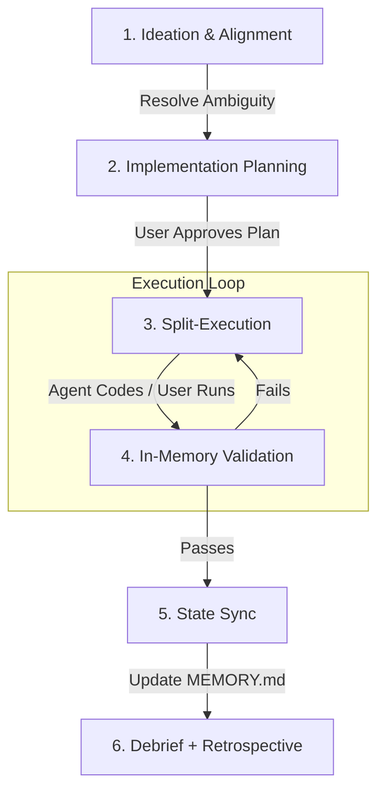

# Personal Ways of Working: Jacques du Toit

This document outlines the specific operational protocols, technical constraints, and agentic workflows required to operate effectively within my environment. It serves as a behavioral baseline for AI agents assisting on this project (DF-14 AI Engineering cohort).

---

## 1. Professional Context & Workflow Philosophy

* **Context:** I am operating within the Kubrick Group, DF-14 AI Engineering cohort.
* **Workflow Style (Plan-First):** I require explicit implementation plans and atomic steps before execution. Do not rush into writing 500 lines of code. We plan, review, and then execute.
* **Split-Workflow Protocol:** Due to corporate sandbox constraints, AI agents are primarily responsible for scaffolding, planning, and documenting. Heavy execution (like spinning up ML pipelines) is handled by me natively in my local terminal to bypass blocking.
* **Continuous Improvement:** At the end of every sprint, write **both** `Docs/SprintN/sprint_debrief.md` (delivery) and `Docs/SprintN/sprint_retrospective.md` (process). They are mandatory and not interchangeable.

## 2. Typical Workflow Lifecycle

### How to Read This Workflow

This diagram visualizes the mandatory execution loop for all AI-assisted work:

* **The Planning Gate:** All tasks start with ideation, followed by an explicit `implementation_plan.md`. Execution (Code) is strictly blocked until the user manually approves the plan.
* **The Split-Execution Loop:** The AI generates the code/scripts, but the User executes them natively in the terminal to bypass corporate AppLocker blocking.
* **The Checkpoint:** Once the validation passes in-memory, the cycle ends by updating the `.agents/MEMORY.md` file to save the state, culminating in **debrief + retrospective** when the sprint ends.

When executing a new feature or task, this is my exact operational loop:

1. **Ideation & Alignment:** Resolve all ambiguity first. If requirements are vague, interrogate the design (e.g., using the `/grill-me` skill) before touching the codebase.
2. **Implementation Planning:** The agent must generate an `implementation_plan.md` artifact detailing exactly what will change. I must explicitly approve it before execution begins.
3. **Split-Execution:** The agent writes the code, Python scripts, or markdown. I take over to run the execution commands locally in my terminal (using `cmd.exe` syntax and the `py` launcher) and to review, edit and approve the code.
4. **In-Memory Validation:** Tests are run in-memory (e.g., using `httpx.ASGITransport` for FastAPI) to bypass AppLocker loopback restrictions.
5. **State Sync:** Once verified, the agent updates `.agents/MEMORY.md` to reflect the new state, and we commit.
6. **Milestone close-out:** At the end of a sprint, write/update `sprint_debrief.md` (delivery) **and** `sprint_retrospective.md` (keep/stop/start + skillify).

## 3. Technical Stack Preferences

When generating code or architecture, default to the following stack:

* **Language:** Python 3.13
* **Dependency Management:** `uv` (preferred) or standard `pip` if `uv` is unavailable.
* **Web Framework:** FastAPI
* **Testing:** `pytest` (prefer in-memory ASGI transport testing over local port binding).
* **AI Models:** Azure OpenAI (using the specific training endpoint configuration).

## 4. Environment & Security Constraints (Corporate Windows)

This is a heavily governed corporate environment. The following rules are absolute:

* **AppLocker Restrictions:** Executables in user-writable folders (like `.venv/Scripts/python.exe`) are blocked. All Python scripts MUST be executed using the global launcher module syntax (e.g., `py -3.13 -m pytest` or `py -3.13 script.py`).
* **EDR/Antivirus:** Real-time scanning destroys disk I/O. Avoid writing thousands of small files (like image datasets); pack data into `.parquet` or use in-memory databases.
* **Loopback Blocks:** Local port binding (`127.0.0.1`) can be flaky in the sandbox. Use in-memory testing for APIs where possible.
* **Zero Secret Leakage:** Never log, print, or commit raw Azure OpenAI API keys or endpoints. Always use environment variables (`os.environ.get()`).

## 5. Documentation & Agentic Memory

* **Staff-Level Standards:** Documentation must not be speculative. Document what actually exists.
* **The Memory Bank:** The `.agents/MEMORY.md` file is the central nervous system of this project. It must be updated at the end of every context switch to preserve continuity.
* **Single Source of Truth:** `.agents/AGENTS.md` holds the immutable rules.
* **Event Synchronization Protocols:** To ensure documentation remains strictly in sync after major events (meetings, feature drops):
  1. **The Anchor Method:** Update `.agents/MEMORY.md` immediately. This serves as the anchor point for all downstream context.
  2. **The Cascade Prompt:** Use explicit commands (e.g., "audit and cascade updates") to force the AI to `grep_search` and update all dependent PRDs, Sprint Plans, and ADRs.
  3. **Rule #4 Trigger:** At the end of a sprint/milestone, explicitly command the AI to "trigger the end-of-milestone documentation protocol" to generate/update `walkthrough.md`, `sprint_debrief.md`, **and** `sprint_retrospective.md`.
  4. **Skillification:** Use the `/agent-skillify` workflow to convert complex operational workarounds or recurring tasks into permanent rules/skills.

## 6. Certification Alignment

Work produced in this repository should naturally align with the principles required for my active certifications:

* AWS AI Practitioner
* MS Copilot Studio
* MS AI Agent Builder
