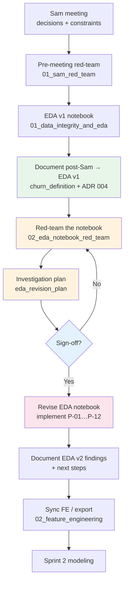

# Sprint 1: AI Engineering Learnings

## Operational & Documentation Workflows
- **Agentic State Synchronization:** Relying on the AI to "remember" cross-file dependencies is a risk. To mitigate this, we enforce a strict synchronization protocol after major events (like stakeholder meetings).
  - *The Anchor Method:* Always update `.agents/MEMORY.md` immediately after an event. It serves as the single source of truth for the workspace state.
  - *The Cascade Prompt:* Explicitly command the agent to "audit and cascade updates" to force a `grep_search` across PRDs, Sprint Plans, and ADRs to update outdated context.
  - *Rule #4 Triggers:* Rely on the explicit rules defined in `AGENTS.md` (end-of-milestone protocol) to generate/update `walkthrough.md`, `sprint_debrief.md`, **and** `sprint_retrospective.md`.
  - *Skillification:* If a manual documentation or operational workaround is complex, convert it into a permanent rule or skill (Sprint 1 example below).

### Skillified: `/docs-before-code`

**Proven in this sprint** when the post-Sam EDA notebook was red-teamed. Jumping straight into cell edits would have risked silent label unlocks and lost the audit trail.

| | |
|---|---|
| **Skill** | `.agents/skills/docs-before-code/SKILL.md` (private development note; omitted from this public snapshot) |
| **Triggers** | “docs before code”, “/docs-before-code”, “red-team then revise”, revising an *implemented* artifact after critique |
| **Contract** | Attack note → signed checklist (implement / investigate / defer + label-unlock gates) → code → doc cascade (`MEMORY`, walkthrough, PRD/ADR only if decision or $ method changed) |
| **Not for** | Greenfield ambiguity (`/grill-me`) or obvious one-line bugfixes |
| **Retro** | [sprint_retrospective.md](sprint_retrospective.md) §5 |

**Rule of thumb:** If the temptation is “the red-team found gaps → open the notebook,” stop and run `/docs-before-code` first.

## EDA revision process (docs before code) — worked example

This section is the Sprint 1 **instance** of `/docs-before-code`. After the Sam meeting we locked a churn definition and rebuilt EDA. A later red-team of that notebook surfaced gaps (missing calendar months, weak AUM proxy, recurring positives, ops lead-time, DQ/fairness). The correct way to absorb that feedback is **not** to jump straight into notebook edits.

### The plan (ordered)

1. **Document what the meeting taught us and how that changed EDA v1** (including the pre-meeting / post-meeting red-team outcomes).  
   - Narrative: `Docs/Sprint1/churn_definition.md`  
   - Decisions: meeting notes + ADR 004  
   - Concepts: `ML_Learnings.md`  
2. **Document what we will change next to investigate further** (including a fresh red-team of the *current* notebook and an explicit investigation checklist).  
   - Attack surface: e.g. `Docs/StakeholderManagement/Meetings/02_eda_notebook_red_team.md`  
   - Checklist: e.g. `Docs/Sprint1/eda_revision_plan.md` (implement / investigate / defer per item)  
3. **Only then revise the EDA notebook** against that checklist (red-team items implemented or consciously deferred).  
4. **Document new findings and next steps** (update `churn_definition.md`, walkthrough / Code Walkthrough, `MEMORY.md`; touch ADR 004 only if the *locked decision* changes).  
5. Proceed to feature export / modeling once the revised EDA story is stable.

### Process diagram

- **Green** — document what we learned  
- **Orange** — critique + plan (**no code**)  
- **Blue** — human gate  
- **Pink** — code  

Live checklist / “you are here”: [eda_revision_plan.md](eda_revision_plan.md) — **P-01…P-12 closed**; FE export done; retrospective filed. Reusable skill: `/docs-before-code`. Next = Sprint 2 modeling. See [walkthrough.md](walkthrough.md), [sprint_debrief.md](sprint_debrief.md), [sprint_retrospective.md](sprint_retrospective.md).

### Why this is the correct plan

- **Separates learning from implementation.** Meeting → EDA v1 is a closed story. Red-team → revision is a new loop. Mixing them in one undifferentiated doc (or only in chat) makes it impossible to show stakeholders *what changed because of Sam* vs *what changed because we attacked our own work*.
- **Red-team before code turns criticism into a checklist.** Writing the attack and the revision plan first forces severity, success criteria, and deferrals. Editing the notebook first invites ad-hoc fixes and silent scope creep (e.g. quietly changing the locked label).
- **Matches staff-level doc rules.** ADR / churn definition stay the source of truth for the *decision*; the notebook is the implementation. Speculating in code without updating the decision trail violates the “codebase + ADR” discipline in `AGENTS.md`.
- **Protects the locked label.** Investigation can confirm or challenge ADR 004. Documenting the plan first makes “we are measuring X; we will only unlock the label if Y” an explicit gate instead of an accidental rewrite.
- **Fits agentic workflows.** Agents (and future-you) need a written checklist and `MEMORY.md` next-step, not a long chat. Docs-first means the next session can execute without re-deriving intent.
- **Demo / report ready.** Sprint demos and the final report need a clear arc: stakeholder constraint → EDA evidence → self-critique → stronger EDA → modeling. This process produces that arc as artifacts, not as reconstruction after the fact.
- **Reusable beyond EDA.** The same loop applies whenever an implemented pipeline/notebook is attacked (e.g. Sprint 2 model red-team) — invoke `/docs-before-code`, do not open the training notebook first.

### Revision loop — what we learned executing it

* **Measure before “fix.”** P-01 gap check showed 0% missing months — a planned reindex would have been wasted work (and risk).
* **Wrong window → empty or misleading metrics.** P-03 on the exit month always had 0 active txs (gone = inactive). P-02 prior-month AUM was ~$34; prior-3-month max unlocked the Morgan figure (~$7.27M).
* **Cascade the dollar into the PRD the same day** you lock the method, or the next agent session will still quote $4.2M.
* **Keep attack / plan / learnings / story in different files** (red-team · revision plan · `ML_Learnings` / `ai_bp_learnings` · `churn_definition`) so each audience gets one job per doc.

### Anti-pattern to avoid

Jumping from “red team found gaps” straight into rewriting `01_data_integrity_and_eda.ipynb` without a dated plan. That optimizes for short-term code motion and loses the audit trail the cohort (and Jamie/Sam) expect. **Mitigation:** `/docs-before-code`.
