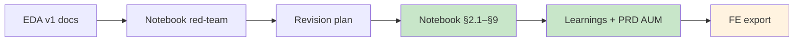

# Sprint 1: EDA Revision Plan (post red-team)

**Status:** Complete 2026-07-10 — all P-01…P-12 closed; label lock unchanged; PRD AUM ≈ $7.27M  
**Red-team source:** [02_eda_notebook_red_team.md](../StakeholderManagement/Meetings/02_eda_notebook_red_team.md)  
**EDA story:** [churn_definition.md](churn_definition.md)  
**Locked decision:** [ADR 004](../Architecture/ADRs/004-churn-target-and-predictive-window.md)  
**Learnings:** [ML_Learnings.md](ML_Learnings.md) · [ai_bp_learnings.md](ai_bp_learnings.md) · [ai_engineering_learnings.md](ai_engineering_learnings.md)  
**Process rationale:** [ai_engineering_learnings.md](ai_engineering_learnings.md#eda-revision-process-docs-before-code)

**Goal:** Turn red-team findings into an ordered investigation / implementation list with success criteria and explicit deferrals. Protect the v1 label lock unless evidence forces an ADR change. **Achieved.**

### You are here

**Done:** red-team → P-01…P-12 → learnings cascade → PRD ~$7.27M. **Next:** `02_feature_engineering.ipynb`.

---

## Gate rules

1. **Docs before code** — this file + red-team must exist (they do) before editing `01_data_integrity_and_eda.ipynb`.
2. **Label lock** — do not change `Is_Churned` math unless an item below is marked `may_unlock_label` and ADR 004 is updated in the same change.
3. **FE notebook** — `02_feature_engineering.ipynb` should follow EDA panel fixes (especially continuous months) so training export matches revised grain.
4. **After revision** — update `churn_definition.md` (v2 findings), Code Walkthrough, `MEMORY.md`; run schema validation if CSV-facing cells change.

---

## Checklist

| ID | Red-team | Action | Where | Success criteria | Unlock label? | Status |
|----|----------|--------|-------|------------------|---------------|--------|
| P-01 | RT-01 | Measure missing calendar-month gaps; if material, reindex to continuous months (fill active=0, carry balance) | Notebook §4.1 | Gap rate reported; after fix, `shift(-1)` aligns with next calendar month for ≥X% of rows (define X after measurement) | Only if gap fix changes who is labeled | done — gap rate 0%; align 100%; no reindex |
| P-02 | RT-02 | Compute AUM-at-exit (balance prior to first left-looking transition); replace §5e coarse proxy | Notebook §9 | Documented $ AUM figure + method; PRD placeholder update proposed | No | done — prior-3-month max **$7.27M** locked in PRD §2 (replaced $4.2M); prior-month ~$34; coarse $2.2M rejected |
| P-03 | RT-03 | Intra-month timing EDA (day of last active tx / £0 cross); note scoring cadence vs 14-day review | Notebook §9 | Histogram + one-paragraph ops recommendation | No | done — prior-month timing 100% coverage; **34% of $0-crosses on day ≤14**; score early in prediction month |
| P-04 | RT-04 | Report first-exit incidence + reactivation count alongside 11.8% prevalence | Notebook §8.1 | Table: prevalence vs first-exit rate vs # customers ever positive | No | done — prevalence 11.76%; first-exit 3.92%; 64% customers ever+; 206k reactivations |
| P-05 | RT-05 | Metrics on subset `gone_this_month == 0` (impending exit cohort) | Notebook §8.1 | Positive rate + note on baseline difficulty for that cohort | No (unless we later redefine training population in ADR) | done — impending pos 10.38%; already-gone 22.18% |
| P-06 | RT-06 | Align `ML_Anti_Patterns.md` example with ADR 004 month t→t+1 + in-month ops buffer | `Docs/Sprint1/ML_Anti_Patterns.md` | Doc matches notebook/ADR | No | done — month t→t+1 example + in-month 14-day buffer |
| P-07 | RT-07 | Quantify negative-balance months | Notebook §9 | Counts; decision note keep/change rounded==0 | Maybe | done — 301,556 neg months (11.23%); almost all round to 0; **keep** rounded==0; no ADR change |
| P-08 | RT-08 | Integrity checklist (dupes, dob, state, account vs customer, date fields, amount identity) | Notebook §2.1 | Pass/fail table for each check | No | done — triage in §2.1 + Data_Dictionary §1.3; re-run after dob fix |
| P-09 | RT-09 | Churn rate by age band + state (eligible rows) | Notebook §9 | Two crosstabs / plots for Jamie | No | done — age bands ~11.0–11.9%; TX 13.43% / CA 10.36% highest-volume spread |
| P-10 | RT-10 | Confirm account_id : customer_id cardinality | Notebook §2.1 | Document 1:1 or multi-account rate | No | done — 100% 1:1 |
| P-11 | RT-11 | Eligible volume + positive rate by Month | Notebook §8.1 | Time-series plot; censoring called out | No | done — 158 months; rate rises early then ~12–14%; 2020-05 censored |
| P-12 | RT-12 | Pick narrative currency convention in docs | `churn_definition` / deck notes | Consistent “round to nearest currency unit” language | No | done — `$` amounts + round-to-nearest-$1 (Sam sense-check) |

---

## Suggested implementation order (when coding starts)

1. **P-08, P-10** — cheap DQ; may change trust in everything else  
2. **P-01** — panel integrity (highest technical risk to the label)  
3. **P-04, P-05, P-11** — interpretability of 11.8%  
4. **P-02, P-03** — Morgan / ops story  
5. **P-07, P-09, P-12** — edge cases + fairness narrative  
6. **P-06** — doc hygiene  
7. Sync **`02_feature_engineering.ipynb`** if panel construction changes  
8. Write **EDA v2 findings** into `churn_definition.md` + next steps in `MEMORY.md`

---

## Explicit non-goals (this revision)

- Retraining XGBoost / MLflow runs  
- Changing prediction horizon away from next month (Sam-locked)  
- Building GenAI / Streamlit Friction-Gate (ops timing is EDA insight only)  
- Committing `training_data.csv` (gitignored; regenerate after FE sync)

---

## Sign-off

- [x] Red-team read and severity accepted  
- [x] This plan’s implement / defer choices accepted  
- [x] Ready to edit `01_data_integrity_and_eda.ipynb`

*(Signed off 2026-07-10 — proceed to notebook revision starting with P-08, P-10.)*
