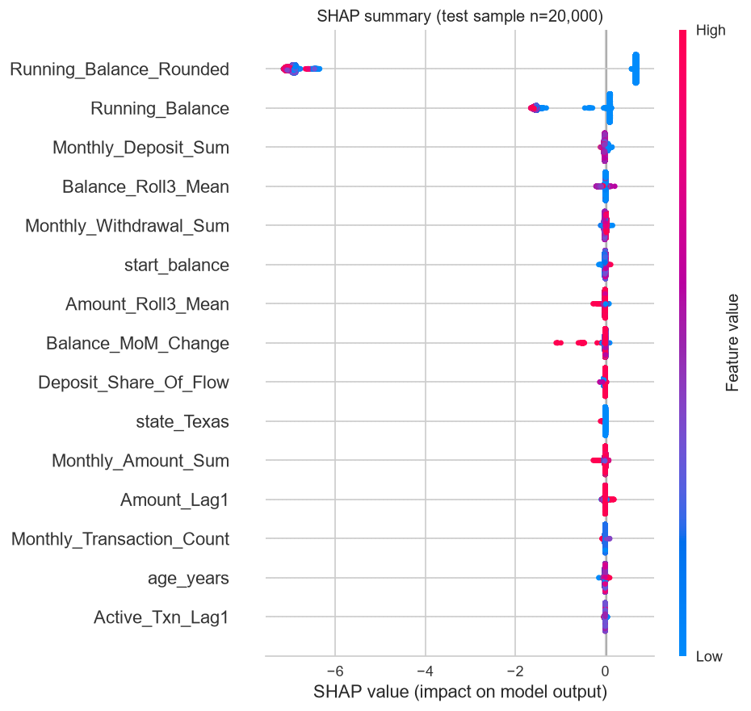

# Meridian Savings — Churn Ranking & Friction-Gate Handover

> [!WARNING]
> **LEGACY — not the live handover deck.** This Marp crib was the Milestone 4 freeze (Sprint 4). The canonical assessor / stakeholder deck is now under `Docs/Presentations/`:
>
> - Generator (source of truth): [`Docs/Presentations/generate_presentation.py`](../Presentations/generate_presentation.py)
> - Presenter view PPTX: [`Docs/Presentations/Meridian_Presentation_PresenterView.pptx`](../Presentations/Meridian_Presentation_PresenterView.pptx)
> - Standalone PPTX: [`Docs/Presentations/Meridian_Presentation_Standalone.pptx`](../Presentations/Meridian_Presentation_Standalone.pptx)
> - Optional older outline (crib notes only): [`Docs/Presentations/presentation.md`](../Presentations/presentation.md) — prefer the generator + dual PPTX as SoT.

**Audience:** Sam (Data Science) · Morgan (Ops / Retention) · Jamie (Risk) · assessors  
**Numbers:** [Sprint2/reports/sprint2_run_summary_v2.json](../Sprint2/reports/sprint2_run_summary_v2.json) · narrative [ML_Learnings.md](../Sprint2/ML_Learnings.md)  
**Serve:** FastAPI + Streamlit Friction-Gate · ops cut `t≈0.701` · run `3f575754…`  
**Model card:** [Model_Card_Template.md](../Model_Card_Template.md) `1.1.0-sprint3-serving`

> Tip: each `---` is a slide break (Marp / VS Code Markdown Preview Enhanced).

---

## Agenda

1. Problem & churn lock (Sprint 1)
2. Data Pre-processing & Integrity (Sprint 1)
3. Exploratory Analysis & Cohorts (Sprint 1)
4. Ranking DoD — beat the heuristic (Sprint 2)
5. Ops contact policy — capacity, not max-F1
6. Why not 40% precision
7. Explainability & fairness
8. Serve + GenAI Friction-Gate (Sprint 3)
9. Architecture commitments (Jamie / ADRs)
10. Demo path & handover
11. What we are *not* claiming

---

## 90-second talk track

1. **Setup:** ADR 004 churn; leakage-safe customer×month table; **time split** (train past → test future), not a shuffle.
2. **Bar:** Not accuracy. Always-negative ≈87% and useless. We beat `gone_this_month` on **PR-AUC 0.219 vs 0.151** and **ROC-AUC 0.723 vs 0.551**.
3. **Surprise:** Max-F1 (`t=0.475`) flooded ops (~21% prec, **~249k** FP).
4. **Change:** 40% precision ∩ 5% contact **unreachable** → shipped **top 5%** (`t≈0.701`). FPs **248k → 20k**; ranking unchanged.
5. **Ship:** Portable `Models/ops/` + FastAPI + drafts behind Friction-Gate — **no autonomous send**.

---

## The business problem

* Historical AUM at risk (Sprint 1 validated): **~$7.3M**
* Retention capacity is finite → contact policy matters as much as ranking
* GenAI drafts must stay **human-gated** (Jamie / ADR 003)

**Personas:** Sam (model rigor) · Morgan (queue size) · Jamie (compliance)

---

## Churn lock (ADR 004) — one slide

**Left-looking next-month churn:**

* `Running_Balance_Rounded == 0` **and**
* No active transactions in that month

**Training grain:** customer × month · features through observation month `t` only · label = month `t+1`  
**Export:** `Data/processed/training_data.csv` — **2,263,608 × 27**, pos rate **11.76%**  
**Currency narrative:** `$` + round-to-nearest-$1 (Sam sense-check)

---

## Data Pre-processing & Integrity (Sprint 1)

*   **Handling Null Opening Balances:** Imputed missing opening balances with `$0` (`fillna(0)`) to maintain feature availability.
*   **System Placeholder Filtering:** Explicitly filtered out `$0` system-generated placeholder transactions to prevent false-active signals.
*   **Anti-Leakage Engineering:** Engineered rolling averages (`Balance_Roll3_Mean`) and lags using a strict `.shift(1)` to ensure features strictly looked backward from month `t`.
*   **Outlier Retention Strategy:** Kept extreme balance outliers ($\pm1e10$) and missing values (NaNs in early-tenure features) to let our tree-based model partition them natively without destructive transformations.

---

## Exploratory Analysis & Cohorts (Sprint 1)

*   **Portfolio Trends:** Validated historical Assets Under Management (AUM) at risk at **~$7.3M**, establishing the scale of the business opportunity.
*   **Demographic Drivers:** Identified geography and age bands as high-variance slices for model scrutiny (key drivers for fairness analysis later).
*   **Cohort Behavior:** Confirmed that churn risk correlates heavily with account inactivity streaks; accounts inactive for two consecutive months are key drivers.
*   **Visualizations:** Plotted portfolio distributions showing a heavy tail of near-zero balances and sparse activity, guiding the capacity constraint design.

---

## Temporal split — no shuffle

| Role | Months |
|------|--------|
| Fit | ≤ 2016-08 |
| Validation | 2016-09 → 2017-08 |
| Test | **2017-09 → 2020-04** |

Threshold chosen on **validation only**, frozen for test.  
Violating this = threshold-calibration leakage ([ML_Anti_Patterns.md](../Sprint1/ML_Anti_Patterns.md)).

---

## Ranking DoD — beat the heuristic

| Model | PR-AUC | ROC-AUC |
|-------|--------|---------|
| Always-negative | 0.132 | n/a |
| `gone_this_month` heuristic | 0.151 | 0.551 |
| **XGBoost** | **0.219** | **0.723** |

**Do not lead with accuracy.** Always-negative ≈ **0.869** accurate and useless.  
Threshold-dependent accuracy (max-F1 ≈0.51 · ops cut ≈0.84) is **not** the ranking DoD.

**Say out loud:** *“We cleared the real bar on PR-AUC and ROC-AUC — not on accuracy.”*

---

## First-run surprise — max-F1 is not ops-ready

At validation-tuned **max F1** (`t = 0.475`, run `7134cee0`):

| Metric | Value |
|--------|-------|
| Precision | 0.211 |
| Recall | ≈ 1.0 |
| False positives | **248,778** (~62% of test rows flagged) |

**Finding:** Ranking worked; the operating point flooded Friction-Gate capacity.

---

## What we changed — decision policy, not ranking

| Before (`7134cee0`) | After (`3f575754`) |
|---------------------|--------------------|
| Maximize F1 on val | Try prec ≥ 0.40 ∩ sel ≤ 5%; **fallback** = val top-5% quantile |
| `t = 0.475` | **`t ≈ 0.701`** |
| ~249k FP | **20,127 FP** |
| PR-AUC / ROC-AUC | **Unchanged** (0.219 / 0.723) |

**One-liner:** *“Same ranking story. Different rule for who enters the retention queue.”*

---

## Why we could not hit 40% precision

| Contact slice | Val precision (approx.) |
|---------------|-------------------------|
| Top 50% | ~0.21 |
| Top 10% | ~0.23 |
| Top 5% *(shipped)* | **~0.23** |
| Top 1% | **~0.24** |

**40% never appears.** Raising the threshold shrinks the queue; it does not unlock a 40% hit rate.

Three reasons: (1) scores are **ranks** (`scale_pos_weight`), not calibrated probs; (2) PR-AUC is better but still modest; (3) base rate ~12% → 40% needs ~3× enrichment.

---

## Before / after — ops cut (say this)

| | Max-F1 | Ops top-5% |
|--|--------|------------|
| `t` | 0.475 | ≈ 0.701 |
| Test precision | 0.211 | **0.229** |
| Test recall | 0.9997 | **0.090** |
| Test FP | 248,778 | **20,127** |
| Test TP / FN | 66,485 / 17 | **5,964 / 60,538** |
| PR-AUC / ROC-AUC | 0.219 / 0.723 | **same** |

*“PR-AUC and ROC-AUC stay — those measure ranking. False positives collapsed because we stopped contacting most of the book. We accept missing many churners outside the top 5%.”*

---

## SHAP — balance story (expected)

Top mean \|SHAP\| (test sample):

1. `Running_Balance_Rounded`
2. `Running_Balance`
3. `Monthly_Deposit_Sum`
4. `Balance_Roll3_Mean`
5. `Monthly_Withdrawal_Sum`

Consistent with ADR 004 + Sprint 1 Gini leak screen (top feature ≪ 0.50).

Waterfalls: [high risk](../Sprint2/reports/shap_waterfall_high_risk.png) · [low risk](../Sprint2/reports/shap_waterfall_low_risk.png)

---

## Fairness — how we prevent discrimination (Jamie)

**One line:** Measure at the serving cut → filter sparse noise → limit contact capacity → explain with SHAP → human Approve only → **disclose** residual gaps.

| Layer | Control |
|-------|---------|
| Measure | Fairlearn Equalized Odds on **age** + **state** at ops `t≈0.701` |
| Honest slices | Groups with **n ≥ 500** only (reject sparse “EOD = 1.0”) |
| Limit harm | Top ~**5%** contact capacity — model cannot flood any group |
| Explain | SHAP balance/behaviour-led (ADR 004), not a demographic rule |
| Govern | Drafts only; **Approve ≠ Sent**; no `/send` |
| Disclose | Age EOD ≈ **0.16** · State EOD ≈ **0.32** on the model card |

At ops threshold, Equalized Odds **only for groups with n ≥ 500**:

| Slice | First-run artifact | Ops + min-n |
|-------|--------------------|-------------|
| State EOD | **1.0** | **≈ 0.32** (38/55 states) |
| Age EOD | ≈ 0.05 | ≈ 0.16 |

**Board language:** use filtered state EOD (~0.32), **not** 1.0. Full narrative: [Sprint5/fairness_anti_discrimination_narrative.md](../Sprint5/fairness_anti_discrimination_narrative.md).

**Do not claim:** zero bias, or an automated Fairlearn remediator / EOD release gate (not shipped — open with Risk if required).

---

## Sprint 3 — what we shipped

* Portable **`Models/ops/`** — booster + OHE + `serving_meta.json` (not gitignored MLflow alone)
* **FastAPI** — `GET /health`, `POST /score`, drafts CRUD; **no `/send`**
* **GenAI** — stub / Azure / stub_fallback; ZDR scrubber; rate ≤ **3.5%** (Pydantic)
* **Streamlit Friction-Gate** — Approve / Edit / Reject; in-process (AppLocker-safe)
* **pytest** `tests/serving` + `tests/genai` — **36 passed**

Pinned: run `3f575754ae9a42c5a21ea5e476c0af37` · `t ≈ 0.70055` · rule `fallback_quantile_top5pct`

---

## Friction-Gate language (Jamie)

| Phrase | Meaning |
|--------|---------|
| Drafts only | GenAI never auto-mails customers |
| Approve ≠ Sent | Approve = ready for a **human** to send outside the AI system |
| ZDR | No PII to the LLM (scrub inbound context + outbound subject/body) |
| Rate cap ≤ 3.5% | Hard-fail on create and edit |
| No `/send` | Architecture cannot dispatch even if UI is misused |
| Server re-score | Client `flagged` / probability **never trusted** |
| Demo RBAC | Compliance can audit, cannot Approve (pedagogical — not Entra) |
| Attention ack | Approve disabled until reviewer affirms they checked text / rate / drivers |
| High-stakes cue | Stronger banner when score is well above ops cut |
| Fast-decide warn | Soft warn if Approve &lt; ~8s; logged on audit trail |

---

## Architecture commitments (Jamie)

Locked decisions Risk can rely on — not a doc index; full text under `Docs/Architecture/ADRs/`.

| Commitment | Decision | ADR |
|------------|----------|-----|
| HITL / no autonomous send | Drafts only; **Approve ≠ Sent**; **no `/send`** | [003](../Architecture/ADRs/003-friction-as-a-feature-genai-gating.md) |
| Anti rubber-stamp | Approve needs **attention ack**; high-stakes cue; fast decides audited | ADR 003 amendment · [JR-REQ-19](../Sprint5/review_fatigue_mitigation.md) |
| Bounded GenAI I/O | Structured drafts; offered rate **≤ 3.5%** hard-fail | [002](../Architecture/ADRs/002-pydantic-strict-io.md) |
| Glass-Box oversight | Demo RBAC — Compliance can audit, **cannot Approve** (not Entra) | [007](../Architecture/ADRs/007-demo-glass-box-rbac.md) |
| Fairness at serving cut | Measure + disclose EO at ops `t≈0.701` (see Fairness slide) | Model card · [narrative](../Sprint5/fairness_anti_discrimination_narrative.md) |
| Host split caveat | UI and API must share one SQLite host or queues diverge | [008](../Architecture/ADRs/008-split-brain-state.md) |

**Say:** “These are written architecture decisions — the Friction-Gate demo implements them; production IdP/encryption remain out of prototype scope. HITL is not a rubber stamp — Approves require an attention check.”

---

## Defending the Architecture (Red Team Mitigations)

**Defending the Pure-Python RAG (ADR 010):**
> "While vector databases like Chroma provide superior semantic search, our enterprise environment strictly blocks the native C++ compilers and DLLs they rely on via AppLocker. Our mandate is to deliver business value within security constraints, not fight IT. By implementing an in-memory, pure-Python retrieval engine, we guarantee zero execution blocks and zero installation footprint, perfectly aligning with our 'Friction as a Feature' philosophy. The tradeoff in slight semantic accuracy is heavily outweighed by achieving 100% deployability."

**Defending the Docker Volume SQLite Hack (ADR 008):**
> "Typically, a multi-container architecture demands a dedicated database server like PostgreSQL. However, our prototype's core requirement (ADR 006) mandates complete portability. By utilizing a shared Docker volume mapped to a single SQLite file, we maintain the self-contained, lightweight nature of the application. We have mitigated the inherent concurrency risks by implementing strict busy_timeout PRAGMAs and exponential backoff retry loops at the application layer."

Requirements register: [Jamie JR-REQ-*](../Sprint5/jamie_requirements_register.md).

---

## Engineering one-liner (AppLocker / portable ops)

* MLflow SQLite (`mlflow.db`) is **provenance** — gitignored; not the serve load path.
* Serve loads committed **`Models/ops/`** (booster + OHE + `serving_meta.json`).
* Corporate Windows: `py -3.13 -m …` only; Streamlit imports serving **in-process** (no localhost dependency).
* ASGI pytest: **36 passed** without binding a port.

---

## AI Business Partner: The Golden Sequence

**Lesson: Never start with AI. Start with the problem.**
*   **Workflow Constraint:** The bottleneck wasn't a lack of data; it was the Relationship Managers' inability to manually identify and contextually engage churning customers at scale.
*   **Stakeholder ROI Engineering:** We had to balance Sam (Data Science rigor) with Jamie (Risk/Compliance fear). 
*   **The Compromise:** We shipped "Friction as a Feature" (Approve/Reject gates) to satisfy Risk, and dialed the model to a "Capacity Constraint" (top 5%) to satisfy Operations, rather than chasing a theoretical 40% precision.

---

## AI Engineering: GenAIOps & Resilience

**Lesson: Compliance is an API design problem, not just a UI caption.**
*   **Pydantic Determinism:** We hardcoded validation schemas to guarantee the LLM cannot hallucinate unapproved promises (e.g., locking maximum interest rates to 3.5%).
*   **Prompt-as-Code:** Transitioned to `.prompty` files to version-control context grounding and separate prompt logic from backend Python code.
*   **Environment Resiliency:** Successfully bypassed corporate Windows AppLocker and loopback restrictions by using in-process ASGI transports and SQLite backends—without sacrificing the architectural integrity of the FastAPI/Streamlit stack.

---

## AI Orchestration: Managing "Agentic Tunnel Vision"

**The Risk:** AI agents tactically fix local errors (e.g., swapping MLflow to SQLite for AppLocker) but fail to elevate macro shifts to Architecture Decision Records (ADRs).

**The Solution:** We act as AI Orchestrators by enforcing a **4-Part Circuit Breaker**:
1. **Docs-Before-Code:** Explicitly diagnosing major blockers before editing implementation.
2. **Architectural Triggers:** `AGENTS.md` rules force a pause to ask for ADRs on dependency/DB changes.
3. **End-of-Session Reflection:** Agents must explicitly reflect on undocumented structural shifts.
4. **Human-in-the-Loop Diff Reviews:** The orchestrator's final safety net.

---

## Sprint 5 — Containerization, Multi-page UI, & RAG

* **Docker Compose (`docker-compose.yml`)** — wrapping FastAPI and Streamlit into portable containers for local and cloud deployment.
* **Multi-Page Dashboards** — splitting the UI into a Business View (Morgan) for operational approvals and an ML/What-If View (Sam) for Data Science diagnostics.
* **RAG Q&A Bot** — introducing a Retrieval-Augmented Generation chatbot grounded in the `final_report.md` for stakeholders to query project outcomes interactively.
* **Anti-Rubber Stamp (JR-REQ-19)** — enhanced Jamie's risk gates with an `attention_ack` checkbox and `seconds_open` auditing to prevent review fatigue.

---

## Live demo sequence (keep this order)

1. `GET /health` — run id + threshold + `azure_configured`
2. Streamlit preset **Below threshold** (~0.21) → **no draft** (capacity discipline)
3. Preset **Flagged** (~0.75) → create draft → Approve / Edit / Reject
4. Say explicitly: **“Approved is not sent.”**

Fixtures: [fixtures/](fixtures/) · Commands → [demo_runbook.md](demo_runbook.md)

---

## What we are *not* claiming

* ❌ 40% precision inside the contact budget (infeasible on these scores)
* ❌ Calibrated probabilities (“0.70 = 70%”)
* ❌ Autonomous outreach or full Glass-Box RBAC
* ❌ ROC-AUC > 0.85 (PRD aspirational; shipped DoD = beat heuristic)

**If Sam later needs ≫23% precision:** calibration / model lift — **new work item**, not another max-F1 hunt.

---

## Handover map

| Need | Where |
|------|-------|
| This deck | [presentation.md](presentation.md) |
| Full ML narrative | [ML_Learnings.md](../Sprint2/ML_Learnings.md) |
| Final report | [final_report.md](final_report.md) |
| Demo commands | [demo_runbook.md](demo_runbook.md) |
| Model card | [Model_Card_Template.md](../Model_Card_Template.md) |
| Ops numbers | `Docs/Sprint2/reports/sprint2_run_summary_v2.json` |
| First-run freeze | `sprint2_run_summary.json` (**do not overwrite**) |
| ADR 003 Friction-Gate | [003-friction-as-a-feature-genai-gating.md](../Architecture/ADRs/003-friction-as-a-feature-genai-gating.md) |
| ADR 004 Churn lock | [004-churn-target-and-predictive-window.md](../Architecture/ADRs/004-churn-target-and-predictive-window.md) |
| ADR 005 Portable ops | [005-portable-model-export-for-serving.md](../Architecture/ADRs/005-portable-model-export-for-serving.md) |
| ADR 006 SQLite UI | [006-sqlite-and-in-process-ui-for-friction-gate.md](../Architecture/ADRs/006-sqlite-and-in-process-ui-for-friction-gate.md) |
| Demo fixtures | [fixtures/](fixtures/) |

---

## Closing line

> We rank better than a strong heuristic, contact only the top 5% of scores so the queue is reviewable, and every GenAI draft stops at a human — by design.
