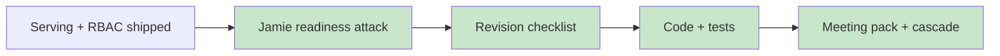

# Sprint 5: Jamie Readiness Revision Plan (post serving attack)

**Status:** Complete 2026-07-16 — JR-01…JR-06 closed; JR-07/JR-08 deferred to Jamie / Jacques  
**Attack note:** [06_jamie_serving_readiness_red_team.md](../StakeholderManagement/Meetings/06_jamie_serving_readiness_red_team.md)  
**Meeting pack:** [04_jamie_sprint5_risk_prep.md](../StakeholderManagement/Meetings/04_jamie_sprint5_risk_prep.md)  
**Prior (related):** [sprint5_impl_red_team.md](sprint5_impl_red_team.md)  
**Process:** `/docs-before-code` — see [ai_engineering_learnings.md](ai_engineering_learnings.md)

**Goal:** Close offline Risk gaps before the Arvind (Jamie) meeting without unlocking churn label, ops threshold, or inventing production SSO.

### You are here



**Process miss (recorded):** Code for JR-01…JR-03 landed in the same session **before** this checklist existed. Sign-off is retroactive via this dated plan; future critique→revise loops must stop at Phase 3.

---

## Gate rules

1. **Docs before code** — attack note + this checklist should exist before editing `src/serving/` / `src/genai/` for Risk critique (enforced going forward).
2. **No label / threshold unlock** — do not touch ADR 004 or ops `t≈0.701` / run freeze.
3. **No speculative prod auth** — do not invent Entra or encryption runbooks (anti-speculation); defer to Jamie.
4. **After revision** — cascade meeting prep, ADR 007 clarifications, demo runbook counts, BP learnings fairness numbers, `MEMORY.md`.

---

## Checklist

| ID | RT | Action | Success criteria | Unlock? | Status |
|----|----|--------|------------------|---------|--------|
| JR-01 | RT-J-01 | **implement** | `GET /drafts` + `GET /drafts/{id}` require `view_queue` + role parse; tests cover compliance view + bad role 400 | No | **done** |
| JR-02 | RT-J-02 | **implement** | `_enforce` records `action=denied` with permission + actor_role; test asserts audit after compliance Approve 403 | No | **done** |
| JR-03 | RT-J-03 | **implement** | `sanitize_llm_draft` scrubs subject + body; unit test with email/phone in both | No | **done** |
| JR-04 | RT-J-04 | **implement** | Sprint 2 `ai_bp_learnings` quotes ops fairlearn JSON (age ≈ 0.16, state ≈ 0.32) | No | **done** |
| JR-05 | RT-J-05 | **implement** | `04_jamie_sprint5_risk_prep.md` has readiness matrix, fairness one-pager, agenda, questions | No | **done** |
| JR-06 | RT-J-06 | **implement** | demo_runbook + presentation pytest counts = **28**; compliance checklist mentions denied-audit + GET RBAC | No | **done** |
| JR-07 | RT-J-07 | **defer** | Jamie decides: fairness EOD gate? extra audit fields? Entra timeline? | Policy | **deferred** — ask in meeting §2 Q5–Q6 |
| JR-08 | RT-J-08 | **defer** | Live Azure: user sets `AZURE_OPENAI_ENDPOINT` | Creds | **deferred** — Jacques |

**ADR touch:** ADR 007 clarified (GET + denied audit) — pedagogical decision unchanged. No new ADR.

---

## Verification

```cmd
set PYTHONPATH=%CD%
py -3.13 -m pytest tests\serving tests\genai -q
```

Expect: **28 passed**.

---

## Cascade (Phase 5)

| Doc | Updated? |
|-----|----------|
| Attack note `06_…` | yes |
| This checklist | yes |
| ADR 007 | yes (clarify) |
| `04_jamie_sprint5_risk_prep.md` | yes |
| `demo_runbook.md` / `presentation.md` | yes |
| Sprint 2/3 `ai_bp_learnings.md` | yes |
| `progress.md` / Sprint 5 eng learnings | yes |
| `.agents/MEMORY.md` | yes |
| Walkthrough / debrief | **no** — mid-sprint; dual close-out at Sprint 5 end |
| PRD / $ metrics | **n/a** |

---

## Sign-off

| Gate | Who | When |
|------|-----|------|
| Retroactive accept of JR-01…JR-06 as shipped | Jacques (implicit — meeting prep request) | 2026-07-16 |
| JR-07 / JR-08 | Jamie + Jacques | In / after Arvind meeting |
