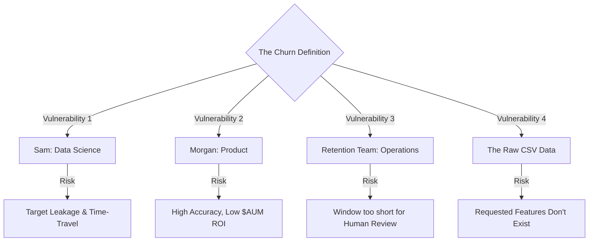

# Red Team Analysis: Sam (Head of DS) Meeting Agenda

**Objective:** Critically attack the current `01_sam_churn_definition_prep.md` agenda to expose blind spots, technical risks, and political misalignments before you step into the room with the Head of Data Science.

## The Stakeholder Tug-of-War (Visualized)

### How to Read This Diagram
This visual maps the four competing pressures you will face when trying to define "Churn". 
* **Data Science (Sam)** naturally pushes for whatever definition yields the highest statistical accuracy (ROC-AUC), but risks introducing *Target Leakage* if they don't split time correctly.
* **Product (Morgan)** pushes for protecting revenue, but if the definition treats all accounts equally, you risk ignoring the `$4.2M` goal in favor of volume.
* **Operations (Retention Team)** requires actionable lead-time; a highly accurate 15-day prediction is useless if it takes 14 days to legally approve an email.
* **The Raw Data** acts as the final reality check; you cannot define churn using theoretical metrics (like "stopped depositing salary") if the CSVs don't actually contain that granular categorization.

## 🚨 Vulnerability 1: The Target Leakage Trap
*   **The Flaw:** We are asking Sam for the mathematical definition of churn (e.g., "$0 balance for 30 days"), but we are not establishing the temporal boundaries for feature engineering. If Sam gives a lagging indicator (it takes 60 days to confirm churn), how do we prevent the model from accidentally "looking into the future" during training?
*   **The Fix:** Add a specific technical question for Sam: *"Given your definition, how do you typically handle temporal data splits at Meridian to prevent target leakage? Specifically, what is the exact cutoff date between the 'feature window' and the 'target window'?"*
*   **Outcome (Post-Meeting):** Sam delegated the exact definitions to us. We now own the responsibility of explicitly defining the "Observation Cutoff" vs. "Prediction Window" in our EDA to prevent leakage. We have agreed on a 1-month forward prediction window.

## 🚨 Vulnerability 2: Morgan's ROI vs. Sam's ROC-AUC (The Metric Disconnect)
*   **The Flaw:** Sam is a Data Scientist whose instinct is to define churn as a binary classification (1 or 0) and optimize for ROC-AUC accuracy. However, Morgan (Product) judges success by **AUM preserved** (currently using a $4.2M proxy placeholder in our PRD). If Sam's definition treats a $10 account leaving exactly the same as a $500k account leaving, we will build a highly accurate model that completely fails the business objective.
*   **The Fix:** You must force Sam to reconcile the DS metric with the Product metric: 
    1. *"Should we treat churn as a strict binary classification, or should we weight the XGBoost loss function by the customer's Running Balance so the model prioritizes high-value clients?"*
    2. *"Before we finalize our OKRs for Morgan, can we use the EDA outputs today to mathematically calculate the true historical AUM lost to churn, so we can replace our PRD placeholder with hard data?"*
*   **Outcome (Post-Meeting):** Sam did not mandate a specific metric, leaving us with autonomy. We must therefore proactively ensure we don't fall into the ROC-AUC trap. We still need to calculate the true historical AUM lost in our EDA and consider weighting our model by customer balance to align with Morgan's goals.

## 🚨 Vulnerability 3: Operational Reality (The Retention Team)
*   **The Flaw:** We are asking Sam what the predictive window should be (30, 60, or 90 days). Data scientists often push for shorter windows (30 days) because the signal is stronger and accuracy is higher. However, if the retention team requires 14 days to review and approve an email via our "Friction-Gate UI", a 30-day window might mean the email reaches the customer too late to stop the churn.
*   **The Fix:** Ground Sam's technical preference in operational reality. *"If we choose a 30-day predictive window, does the Retention Team have enough lead time to review the GenAI drafts in the Friction-Gate UI and execute the campaign before the customer actually leaves?"*
*   **Outcome (Post-Meeting):** We agreed on predicting the probability of churn in the *next month* (a 30-day window). We must now design our MLOps pipeline to run fast enough to give the Retention Team their required lead time within this 30-day window.

## 🚨 Vulnerability 4: The Data Delusion
*   **The Flaw:** You are asking Sam for the ideal definition of churn. Sam might say, *"Churn is when they stop depositing their monthly salary."*
*   **The Reality Check:** We only have `transactions_tm1_e.csv` and `customers_tm1_e.csv`. If our transaction data doesn't categorize deposits as "Salary", we cannot compute that target.
*   **The Fix:** You must proactively manage Sam's expectations. Bring the exact schema of those two CSVs to the meeting and force Sam to construct the definition *strictly using the columns we actually possess*.
*   **Outcome (Post-Meeting):** We successfully avoided this trap. Sam did not dictate theoretical definitions and instead asked us to "sense check" the data we have, round to the nearest pound, and define the inactivity period based on our own EDA. We are grounded in reality.

---

### Recommended Action (historical — pre-meeting)
Review these revised vulnerabilities. Once you are comfortable with the strategy, the immediate next step in our Memory Bank is to **execute the EDA Notebook (`01_data_integrity_and_eda.ipynb`)** so you have the hard data schemas ready to show Sam for Vulnerability 4.

---

## Status after EDA v1.1 revision (2026-07-10)

EDA label remains locked ([churn_definition.md](../../Sprint1/churn_definition.md), ADR 004). Notebook red-team items **P-01…P-12 closed**.

| Sam item | Status | Evidence |
|----------|--------|----------|
| V1 Observation vs prediction integrity | **Closed** | `t`→`t+1`; P-01 0% gaps; P-06 anti-patterns aligned |
| V2 True historical AUM / avoid ROC-only trap | **Closed** | P-02 prior-3-month max ≈ **$7.27M** in [PRD §2](../../Product/Product_Requirements_Document.md) |
| V3 14-day Friction-Gate inside 30-day window | **Closed** | P-03: 34% of prior-month `$0` crosses by day 14; score early |
| V4 Schema-grounded definition | **Closed** | Label construction + P-08/P-10 |

**Attack log:** [02_eda_notebook_red_team.md](02_eda_notebook_red_team.md)  
**Checklist:** [eda_revision_plan.md](../../Sprint1/eda_revision_plan.md)  
**Next:** feature engineering export (`02_feature_engineering.ipynb`).
