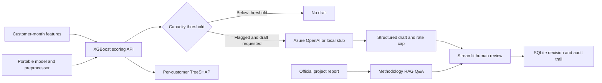

# Meridian | AI-assisted customer retention

**An AI engineering portfolio project by Jacques du Toit.**

Meridian ranks savings customers for retention review, creates constrained email
drafts, and records each human decision. It connects XGBoost to a FastAPI service,
a Streamlit review interface, and Azure OpenAI extensions.

This is a solo course project and engineering demonstration. The bank scenario
and stakeholder roles provide project context. It has no production customers
and makes no claim of measured retention gains.

**Start here:** [Case study and CV summary](Docs/Portfolio/CASE_STUDY.md) ·
[Five-minute demo](Docs/Portfolio/DEMO_GUIDE.md) ·
[Evidence and validation](Docs/Portfolio/EVIDENCE.md)

## What to review

| Skill | Implementation |
|---|---|
| ML evaluation and serving | Time-based evaluation, baseline comparison, model export, and [server-side scoring](src/serving/model.py) |
| Applied generative AI | Azure drafts, versioned prompts, structured output, retries, and [offline fallback](src/genai/drafter.py) |
| Retrieval-augmented generation | Report-grounded Q&A with BM25, optional dense retrieval, reciprocal rank fusion, and [LLM reranking](src/genai/rag_engine.py) |
| Human review and traceability | Capacity gate, review acknowledgement, immutable decisions, and [SQLite audit events](src/serving/draft_store.py) |
| Explainability and risk | [Per-customer TreeSHAP](src/serving/explain.py), measured fairness gaps, and a [model card](Docs/Model_Card.md) |
| Delivery | API container, Azure infrastructure files, [architecture decisions](Docs/Architecture/ADRs/), and [frontend CI](.github/workflows/educational-web-app.yml) |

## System flow



Approved drafts remain in the application. A person must send any message outside
this system. Retention drafts use prompts and constraints; the separate
methodology assistant retrieves evidence from the project report.

## Recorded results

The saved chronological test evaluation covers **September 2017 to April 2020**.
Training and validation use earlier months. No model was retrained for this pass.

| Measure | XGBoost | Existing churn heuristic |
|---|---:|---:|
| Test PR-AUC | 0.219 | 0.151 |
| Test ROC-AUC | 0.723 | 0.551 |

The operating threshold is **0.70055**, selected from the validation top 5% of
scores. At that fixed cut, test precision is **22.9%** and recall is **9.0%**.
The requested 40% precision floor was not met. Scores support ranking and are
not calibrated churn probabilities. A validation top-5% cut does not guarantee
a 5% queue on future data.

Sources: [saved run summary](Docs/Sprint2/reports/sprint2_run_summary_v2.json),
[serving metadata](Models/ops/serving_meta.json), and
[model card](Docs/Model_Card.md), which also records the fairness gaps.

## Try it locally

**Interactive project tour:** requires Node.js 24 and npm. From the repository root:

```bash
cd educational_web_app
npm ci
npm run dev
```

Open the URL printed by Vite, normally `http://localhost:3000`. The tour explains
the project with exercises and simulations. It works without Python, training
data, or Azure credentials. Live scoring and retention review run separately.

**Scoring and human review:** use Python 3.13 and the [setup guide](CLONE_GUIDE.md).
The committed model and two illustrative fixtures work without the training data.
In separate terminals at the repository root, use the configured Python:

```bash
python -m uvicorn src.serving.app:app --host 127.0.0.1 --port 8000
```

```bash
python -m streamlit run Code/Sprint3/friction_gate_app.py --server.address 127.0.0.1
```

Open `http://127.0.0.1:8501`; API health is at `http://127.0.0.1:8000/health`
and API documentation at `http://127.0.0.1:8000/docs`. Leave Azure settings absent
for stub drafts and local BM25 retrieval. The [demo guide](Docs/Portfolio/DEMO_GUIDE.md)
covers expected outputs, review steps, and the API-only Docker option.

## Verification and limits

From the configured Python environment, run `python -m pytest tests -q`.
From `educational_web_app/`, run `npm run lint`, `npm test`, and `npm run build`.
See the dated [evidence record](Docs/Portfolio/EVIDENCE.md) for check results.

- Azure Container Apps was deployed and checked on 24 September 2026, then
  removed. There is no standing URL. The later API-key gate has local tests;
  its Azure check remains open.
- The role picker and `X-Demo-Role` header demonstrate permissions. They do not
  authenticate users. The SQLite deployment uses one replica.
- Raw course data, training exports, credentials, and the MLflow store are absent.
  Retraining needs those files. The prediction browser uses two fixtures unless
  a real cohort is supplied.
- PII filtering uses keys and patterns; it does not provide full name detection
  or a provider data-retention guarantee.
- CI covers the frontend. Python and Docker CI remain open. The learning app
  has technical checks but no completed participant study.

## Repository guide

| Path | Contents |
|---|---|
| [src/](src/) and [tests/](tests/) | Reusable serving/GenAI logic and backend tests |
| [Models/ops/](Models/ops/) | Trained booster, preprocessor, and provenance |
| [Code/](Code/) | Notebooks, export scripts, and Streamlit UI |
| [educational_web_app/](educational_web_app/) | React/TypeScript project tour and tests |
| [infra/](infra/) | Azure deployment files |
| [Docs/Portfolio/](Docs/Portfolio/) | Employer case study, demo, evidence, and sharing guide |
| [Official report](Docs/Final_Report_Official.md) | Detailed project report |
| [Architecture decisions](Docs/Architecture/ADRs/) | Design choices and trade-offs |

[Setup](CLONE_GUIDE.md) · [Technical debt](Docs/Engineering/Technical_Debt_and_Limitations.md) ·
[Sharing and rollback](Docs/Portfolio/SHARING_AND_ROLLBACK.md)
