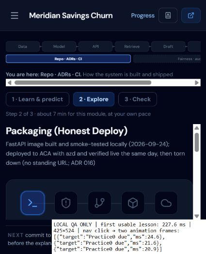

# Learning app technical validation — 2026-10-20

## Scope and approval

The user requested tracking reconciliation, learning-app validation and merge to
`main` on 2026-10-20. They confirmed no participants are available: finish technical
validation and leave the learner trial open. No model, mastery, architecture,
dependency or deployment decision is being changed.

## Findings and checklist

| Finding | Evidence | Action / completion gate |
|---|---|---|
| Stale deployment teaching | Module 11 subtitle/sidebar, lesson, quiz, glossary, two recall questions and the deployment viva still teach scaffold-only hosting; `DEPLOY.status` and ADR 016 record the verified 2026-09-24 deployment and teardown. | Correct teaching/assessment text to match the existing fact; add a failing content-consistency regression test first, then verify production rendering. The revised viva rubric intentionally requires re-marking through the existing signature check. |
| Performance baseline missing | EDU-09 has only bundle sizes. | Measure a production build on this computer; record method, viewport, startup and three Practice transitions. No general performance claim. |
| Tracking drift | Sprint plan, corrections and agent next-step still list completed cloud/benchmark/cleanup work. | Reconcile active status against code and dated evidence, preserving historical records. |
| Live marker unavailable | `uv run python scripts/evaluate_viva_benchmark.py --require-live` fails at its first case with Azure HTTP 401. | Keep live revalidation open; retain 2026-09-24's 87.5% result as historical only. Verify unavailable marking cannot grant credit. |
| No learner participants | Explicit user reply on 2026-10-20. | Leave trial open; do not infer learner outcomes from agent checks. |

Signed scope: the user's instruction above authorizes this reconciliation and
validation. RT-17/RT-18 remain deferred.

## Results

**Local technical validation complete; live marker revalidation blocked; learner
trial open.** Only this task's changes are included. Concurrent UI/theme edits
were excluded at the user's request. The final frontend checks and timings used
an isolated checkout based on `51bd94c` plus the scoped changes in this release.

| Check | Result |
|---|---|
| Python suite | 127 passed; `uv run python -m pytest tests -q` in the primary checkout, whose Python code is unchanged by this release. |
| Frontend suite | 26 passed in 5 files in the isolated checkout (23 existing + 3 deployment-content regression checks). |
| Typecheck / production build | Both pass in the isolated checkout. |
| Generated model facts | `npm run facts:check` passes; no generated fact/image changes. |
| Regression reproduction | The 3 new deployment checks failed before the content correction and pass after it. |
| Live viva benchmark | Failed at first case with Azure HTTP 401; no new accuracy result. Restore valid endpoint/key configuration before rerunning `--require-live`. |
| Learner trial | Not run: user confirmed no participants. No learning-effectiveness claim. |

Warnings: Vite retains its advisory for a chunk over 500 kB. Python emits 10
warnings: an anyio deprecation and scikit-learn estimator-version warnings
(saved with 1.9.0, local runtime 1.9.1). The tests pass, but that does not remove
the model-loading compatibility risk; dependency changes are outside this pass.

## Browser checks

Used an isolated loopback origin and synthetic writing, preserving the user's
normal app progress. Browser checks covered lesson controls, saving a prediction,
Explore, keyboard `End` to Check, numeric recall feedback, Practice, unavailable
marking, draft persistence after reload, separate progress counters, and disabled
final-quiz submission with incomplete prerequisites. No unavailable/self-check
result awarded a marked pass. Corrected module 11's production subtitle renders
the recorded deployment and teardown. The isolated final production page has no
captured browser errors on startup/navigation/deployment view.

Reset cancellation/confirmation, backup recovery, export/import validation and
stale-grade handling are covered by existing frontend tests. A native reset
dialog interaction in the browser timed out, so **browser cancellation is not
claimed as verified**. The disposable synthetic progress on that QA origin was
reset. This did not touch progress at the normal app origin.

The final browser viewport was **425 × 524 CSS px**. Document `scrollWidth` and
`clientWidth` were both 425 on inspected views; the system map has its own
horizontal scroll. This pass does not claim a fresh desktop/mobile-device matrix
or full accessibility certification; earlier viewport evidence remains dated.

## Local performance baseline (EDU-09)

- Device: Windows 11 Pro 10.0.26200; AMD Ryzen 7 PRO 5850U; 15.3 GiB total physical RAM reported by Windows.
- Browser: Codex in-app Chromium browser; engine version not recorded. Viewport 425 × 524.
- Build: Vite 6.4.3, Node 24.19.0; final JS 1,088.77 kB / 336.54 kB gzip; CSS 71.19 kB / 11.39 kB gzip.
- Network: loopback, no network/CPU throttling. QA server returns `Cache-Control: no-store`, including assets. OS/process caches are not flushed; these are not cold-device or public-network measurements. The server does not gzip responses; the gzip figure above is Vite's estimate.
- Method: `node scripts/validation-preview.mjs` serves the existing production `dist/` with a QA-only timing panel injected into responses. It does not modify the build files. Startup is navigation-start to a lesson panel containing a control, followed by two animation frames. Navigation is the menu's Practice click to two animation frames; the destination heading was separately verified. This is a render-readiness proxy, not INP or another Core Web Vital. Menu-opening time is excluded.

| Measurement | Samples (ms) | Median (ms) |
|---|---|---|
| First usable lesson, first visit + two no-store reloads | 244.0, 142.7, 227.6 | 227.6 |
| Lesson 01 → Practice, three menu clicks | 24.6, 21.6, 20.9 | 21.6 |

Reproduce with `npm run build`, then the QA preview command (optionally set
`VALIDATION_PORT` if the default 4317 is occupied). Start from lesson 01 for
startup samples. A restored Practice screen does not satisfy the lesson predicate
and must not be reported as a startup sample. Retain RT-18's code-splitting
deferral: these three local samples provide a baseline, not evidence that every
learner's device/network is fast, or that splitting is necessary.

## Handover

`task.md`, Sprint 5 plan/progress/close-out notes, the corrections register,
learning-app plan/checklist/README and project agent state now agree. Historical
sections remain explicitly dated. No new architecture, infrastructure or
data-flow decision was made; ADR 016 already records the deployment facts.
The deployment viva rubric changed to require the actual demo/teardown evidence;
the existing rubric-signature check requires obsolete answers to be re-marked.

Remaining validation: valid Azure credentials for live revalidation; real
participants for the [learner trial](usability_trial_guide.md). Neither is
represented as passed.
